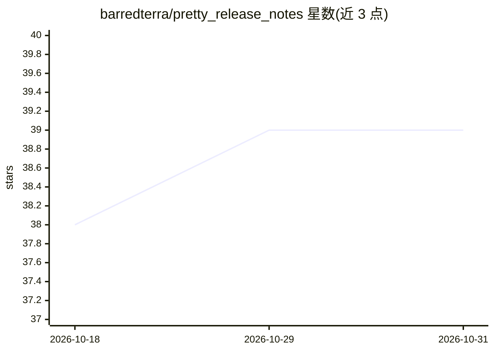

# barredterra/pretty_release_notes

⭐ 39 · Python · MIT · 推送 2026-08-23 · [GitHub](https://github.com/barredterra/pretty_release_notes) · 个人维护

**用 LLM 把 GitHub 自动生成的发布说明改写成可读句子**

面向维护 GitHub 项目的开发者（默认提示词面向 ERPNext/Frappe）：读取 GitHub 自动生成的 release notes，结合 PR 描述、关联 issue 与代码 diff 调用 LLM 生成面向用户的摘要句，并自动过滤 chore/ci/refactor 等非用户可见变更、检测同版本内被回退的 PR、为 backport 复用原 PR 摘要、排除机器人并署名作者与审阅者。提供 CLI、Python 库与 REST API 三种模式，带数据库缓存与轮询自动生成，配置采用 TOML（config.toml）。

## 筛选速览

| 维度 | 判定 | 备注 |
|---|---|---|
| AI 角色 | `ai-native` | 本体是模型或模型工具 |
| 许可风险 | `permissive` | MIT |
| 部署形态 | `library` | 以包/库形式分发 |
| 模型依赖 | — | README 未给出锁定关系 |
| 硬件要求 | — | 无带数字的原话,不猜 |
| 安装摩擦 | `low` | 无编译、无系统依赖或容器化 |
| 成熟度 | — | 结构信号不足 |

## 能力要点

- LLM 将技术性 PR 标题转写为面向用户的句子
- 自动过滤非用户可见变更、回退 PR 与 bot 贡献者
- backport 复用原 PR 摘要，保持一致性
- CLI / Python 库 / REST API 三种模式与摘要缓存

## 适用场景

- 把项目的自动生成发布说明改写成用户可读的版本日志
- 新 release 发布后自动轮询生成并发布说明
- 在自有服务中集成发布说明生成 API

## 场景标签

`AI 写作` · 领域:内容生成

## 证据(README 行号)

> L13: - **AI-Powered Summaries** - Converts technical PR titles into clear, user-friendly sentences
> L21: - **Rich Context** - Incorporates PR descriptions, linked issues, and code diffs for accurate summaries

## 星数曲线

2026-10-18 38 → 2026-10-31 39（+1）

---
*卡片 v1 · prompt 1.4 · 生成 2026-10-25 · 置信度 high · 依据 README sha `ddfd050e5731` · [字段定义](../../DATASET.md)*
