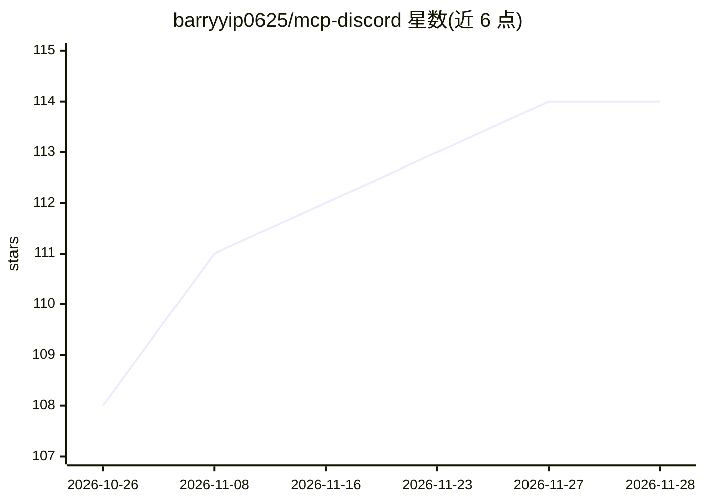

# barryyip0625/mcp-discord

⭐ 114 · TypeScript · MIT · 推送 2026-11-26 · [GitHub](https://github.com/barryyip0625/mcp-discord) · 个人维护

**让 AI 助手通过 MCP 协议操作 Discord 的服务器**

实现 Discord 的 MCP (Model Context Protocol) 服务器，向 AI 助手暴露一组 Discord 操作工具：登录 Discord bot、列出/查询服务器与成员、收发与转发频道消息（含 embed 与附件）、反应与置顶管理、频道与分类增删改、权限覆盖设置、论坛帖子与标签管理、定时事件、webhook 管理等。支持 stdio 与 streamable HTTP 两种传输方式，HTTP 模式要求 Bearer 认证；附件 URL 采用白名单机制限制 SSRF。需自建具备相应权限与 Intents 的 Discord bot token。

## 筛选速览

| 维度 | 判定 | 备注 |
|---|---|---|
| AI 角色 | `ai-ecosystem` | LLM/agent 周边工具 |
| 许可风险 | `permissive` | MIT |
| 部署形态 | `self-host` | docker 或自建部署 |
| 模型依赖 | — | README 未给出锁定关系 |
| 硬件要求 | — | 无带数字的原话,不猜 |
| 安装摩擦 | `low` | 无编译、无系统依赖或容器化 |
| 成熟度 | — | 结构信号不足 |

## 能力要点

- 约 40 个 Discord MCP 工具：消息、频道、论坛、角色、webhook、定时事件
- 支持 stdio 与 streamable HTTP 传输，HTTP 模式带 Bearer token 认证
- 附件发送带 URL 白名单与 25MiB 大小上限，防开放 SSRF 代理
- 提供 NPM、Docker 镜像、Smithery 与源码四种安装途径

## 适用场景

- 让 Claude/Cursor 等 MCP 客户端代为读取与发送 Discord 消息
- 通过 AI 助手管理 Discord 服务器的频道、角色与论坛帖子
- 自托管 HTTP MCP 端点供远程 MCP 客户端连接

## 场景标签

 · 领域:AI 生态/MCP 工具

## 证据(README 行号)

> L6: A Discord MCP (Model Context Protocol) server that enables AI assistants to interact with the Discord platform.
> L14: MCP-Discord provides the following Discord-related functionalities:

## 星数曲线

2026-10-26 108 → 2026-11-28 114（+6）

---
*卡片 v1 · prompt 1.4 · 生成 2026-11-28 · 置信度 high · 依据 README sha `002f2cee30ce` · [字段定义](../../DATASET.md)*
