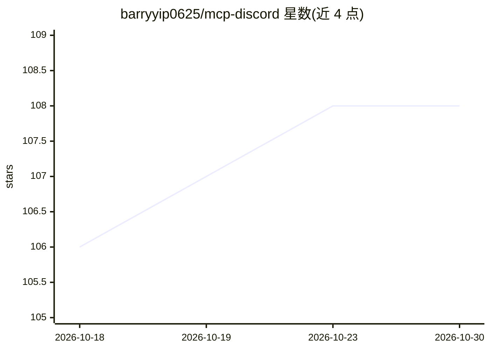

# barryyip0625/mcp-discord

⭐ 108 · TypeScript · MIT · 推送 2026-09-07 · [GitHub](https://github.com/barryyip0625/mcp-discord) · 个人维护

**让 AI 助手操作 Discord 的 MCP 服务器**

基于 Node.js 的 Discord MCP（Model Context Protocol）服务器，向 AI 助手暴露 40 余个 Discord 工具：服务器与成员查询、消息读取/编辑/搜索/发送、频道与分类管理、论坛帖子与标签操作、Webhook 与角色管理、消息反应与置顶。需 Discord bot token 及相应权限，支持 stdio 与 streamable HTTP 两种传输；可通过 npx、Smithery、Docker 或源码安装，并给出 Claude Desktop/Cursor 的接入配置示例。

## 筛选速览

| 维度 | 判定 | 备注 |
|---|---|---|
| AI 角色 | `ai-ecosystem` | LLM/agent 周边工具 |
| 许可风险 | `permissive` | MIT |
| 部署形态 | `self-host` | docker 或自建部署 |
| 模型依赖 | — | README 未给出锁定关系 |
| 硬件要求 | — | 无带数字的原话,不猜 |
| 安装摩擦 | `low` | 无编译、无系统依赖或容器化 |
| 成熟度 | — | 结构信号不足 |

## 能力要点

- 覆盖消息、频道、论坛、Webhook、角色、成员等 40 余个 Discord 工具
- 支持 stdio 与 streamable HTTP 两种 MCP 传输方式
- 提供 npx 一行运行、Smithery 自动安装与 Docker 镜像

## 适用场景

- 让 Claude/Cursor 等 MCP 客户端直接读写 Discord 服务器消息
- 通过对话式 AI 管理 Discord 频道、论坛帖与角色
- 以 HTTP 端点自托管供远程 MCP 客户端连接

## 场景标签

 · 领域:AI 工具集成/聊天平台

## 证据(README 行号)

> L6: A Discord MCP (Model Context Protocol) server that enables AI assistants to interact with the Discord platform.
> L116: A Discord bot token is required for proper operation. The server supports two transport methods: stdio and streama

## 星数曲线

2026-10-18 106 → 2026-10-30 108（+2）

---
*卡片 v1 · prompt 1.4 · 生成 2026-10-23 · 置信度 high · 依据 README sha `01de88984cf6` · [字段定义](../../DATASET.md)*
