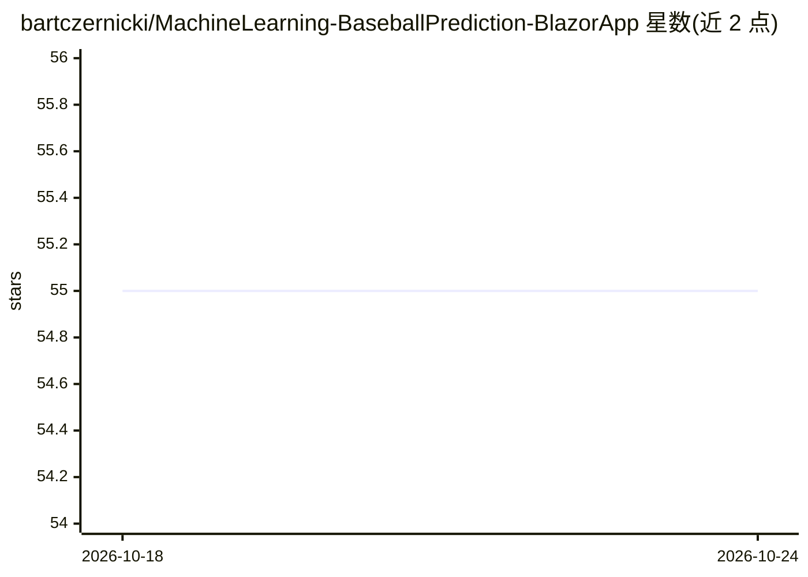

# bartczernicki/MachineLearning-BaseballPrediction-BlazorApp

⭐ 55 · C# · MIT · 推送 2026-10-05 · [GitHub](https://github.com/bartczernicki/MachineLearning-BaseballPrediction-BlazorApp) · [官网](https://baseballaiworkbench-dybyfmbvg8hdctds.b02.azurefd.net/) · 个人维护

**棒球名人堂分析的决策智能演示 Web 应用（Blazor+ML.NET+AI Agent）**

分布式 Web 应用，通过四个递进场景演示决策智能：规则阈值判定、单一 ML.NET 概率模型、两阶段多层级概率、以及三个 AI Agent（统计学家/ML专家/百科检索）加 Agent Q 综合的多 Agent 检索分析。用户可搜索球员、调整假设职业生涯长度并对比实际与假想数据。技术栈为服务端 Blazor、SignalR、Aspire 编排、ML.NET 推理、Microsoft Agent Framework 与 Web IQ 检索，模型托管于 Microsoft AI Foundry 与 Azure OpenAI。提供 Docker 本地运行与 Azure 部署集成，以及线上演示站（空闲时缩容至零，启动有延迟）。

## 筛选速览

| 维度 | 判定 | 备注 |
|---|---|---|
| AI 角色 | `ai-native` | 本体是模型或模型工具 |
| 许可风险 | `permissive` | MIT |
| 部署形态 | `None` |  |
| 模型依赖 | locked-api |  |
| 硬件要求 | — | 无带数字的原话,不猜 |
| 安装摩擦 | `medium` | 含编译或系统依赖之一 |
| 成熟度 | — | 结构信号不足 |

## 能力要点

- 四个决策智能场景：规则→概率→多层级概率→多 Agent 检索综合
- 三个独立 AI Agent 分析加 Agent Q 定量综合，展示 Agent 分歧与敏感性区间
- ML.NET 内存内快速预测，覆盖 2025 赛季结束前的历史击球数据
- Docker 本地运行与 Azure Container Apps 部署集成

## 适用场景

- 交互式探索棒球名人堂入选概率与假设职业生涯对比
- 演示决策智能概念：阈值、概率、多 Agent 证据综合
- 学习 .NET/Blazor/Aspire/ML.NET/AI Agent 组合的参考应用架构

## 场景标签

`多智能体` · 领域:Agent 开发

## 证据(README 行号)

> L34: The fourth scenario brings together three AI agents with distinct evidence inputs. Run any agent individually, or s
> L59: - AI agent research and quantitative synthesis using Microsoft Agent Framework and Web IQ.
> L81: - **Model hosting:** Microsoft AI Foundry and Azure OpenAI.

## 星数曲线

2026-10-18 55 → 2026-10-24 55（+0）

---
*卡片 v1 · prompt 1.4 · 生成 2026-10-24 · 置信度 high · 依据 README sha `825b4bf38f52` · [字段定义](../../DATASET.md)*
