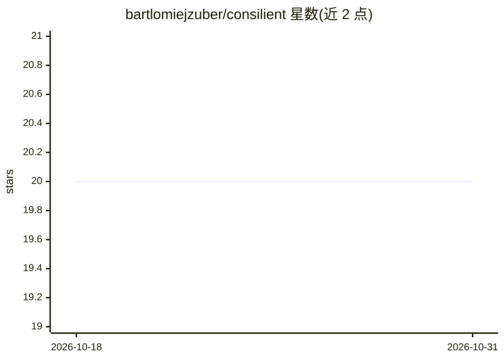

# bartlomiejzuber/consilient

⭐ 20 · MIT · 推送 2026-07-28 · [GitHub](https://github.com/bartlomiejzuber/consilient) · [官网](https://bartlomiejzuber.github.io/consilient/) · 个人维护

**从 PR 审查历史提取团队编码规范供 AI 助手加载的构建规范**

本仓库是一个构建规范（build spec）而非可直接运行的工具：将 SPEC.md 交给编码 agent（如 Claude Code 或任意可运行工作区的 LLM），回答关于 LLM 提供方、Git 托管平台、模型、输出格式与部署的少量问题后，agent 会基于 GitHub/GitLab 等平台的 PR 审查历史搭建流水线。流水线提取团队实际执行的编码规范，剔除 linter 或已有文档覆盖的部分，生成每条规则带置信度、执行频次与来源 PR 的 ruleset 文件，可按计划（默认每周 CI）重跑。

## 筛选速览

| 维度 | 判定 | 备注 |
|---|---|---|
| AI 角色 | `ai-ecosystem` | LLM/agent 周边工具 |
| 许可风险 | `permissive` | MIT |
| 部署形态 | `None` |  |
| 模型依赖 | — | README 未给出锁定关系 |
| 硬件要求 | — | 无带数字的原话,不猜 |
| 安装摩擦 | `low` | 无编译、无系统依赖或容器化 |
| 成熟度 | — | 结构信号不足 |

## 能力要点

- 读取仓库 PR 审查历史，提取团队实际执行的编码规范
- 规则带置信度、执行频次与来源 PR 追溯，低执行阈值规则进单独的候选文件
- 剔除 linter 与已有文档已覆盖的内容
- 提供对 React 仓库的完整示例运行（7 个 PR、52 条审查评论产出 4 条规则）

## 适用场景

- 把团队评审中口口相传的规范变成 AI 编码助手可加载的规则
- 让 ruleset 随新评审持续更新（默认每周 CI 任务）
- 追溯每条 AI 助手规则的来源 PR 与执行频次

## 场景标签

`代码审查` `提示工程` · 领域:Agent 开发

## 证据(README 行号)

> L8: an existing doc already covers, and writes the rest into a ruleset your AI coding assistant loads.
> L12: (Claude Code, or any LLM that can run an agentic workspace), answer a short set of questions about
> L21: 1. Open `SPEC.md` in your coding agent, for example `claude` in this directory.

## 星数曲线

2026-10-18 20 → 2026-10-31 20（+0）

---
*卡片 v1 · prompt 1.4 · 生成 2026-10-28 · 置信度 high · 依据 README sha `cbf62ef9f147` · [字段定义](../../DATASET.md)*
