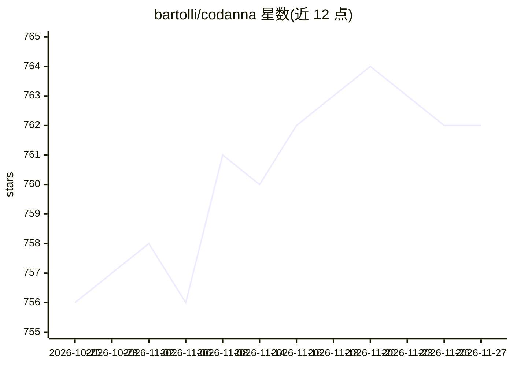

# bartolli/codanna

⭐ 762 · Rust · Apache-2.0 · 推送 2026-11-22 · [GitHub](https://github.com/bartolli/codanna) · [官网](https://docs.codanna.sh/) · 个人维护

**面向 AI 编码 agent 的本地代码智能 MCP 服务器与 CLI**

用 Rust 编写的本地代码索引与语义搜索工具，以 MCP 服务器或一次性 CLI 两种模式运行：一次调用返回符号上下文、调用图与影响分析的预关联结果。支持 15 种语言，提供符号搜索、语义搜索、调用图、依赖跟踪、文档 RAG 与影响分析，可接入 Claude Code、Cursor、Windsurf、Codex、Gemini 等 MCP 兼容客户端。索引存于本地磁盘，嵌入模型首次使用时下载后本地运行，默认不向远程 API 发送源代码；远程 OpenAI 兼容嵌入为可选配置。

## 筛选速览

| 维度 | 判定 | 备注 |
|---|---|---|
| AI 角色 | `ai-ecosystem` | LLM/agent 周边工具 |
| 许可风险 | `permissive` | Apache-2.0 |
| 部署形态 | `library` | 以包/库形式分发 |
| 模型依赖 | — | README 未给出锁定关系 |
| 硬件要求 | — | 无带数字的原话,不猜 |
| 安装摩擦 | `medium` | 含编译或系统依赖之一 |
| 成熟度 | — | 结构信号不足 |

## 能力要点

- 一次 MCP 调用返回符号、签名、调用者/被调用者与递归影响分析
- 支持 15 种语言的本地语义搜索与调用图
- 持久 MCP 服务器与一次性 CLI 双模式
- 本地优先：默认不外发源代码，嵌入模型本地运行

## 适用场景

- 让 AI 助手回答『这个函数在哪里被调用』而非 grep 结果
- 变更符号前查看完整的跨文件依赖与影响范围
- 对项目文档建立 RAG 索引并与代码一起查询

## 场景标签

`编码 Agent` `RAG` `语义搜索` · 领域:编码与开发

## 证据(README 行号)

> L21: Codanna is a local code intelligence and semantic code search MCP server for AI coding agents. One MCP call returns
> L23: It indexes your repository on disk and serves symbol search, semantic search, call graphs, dependency tracking, doc
> L64: Codanna runs on your machine. The repository index lives on disk under `.codanna/`. The embedding model downloads o

## 星数曲线

2026-10-25 756 → 2026-11-27 762（+6）

---
*卡片 v1 · prompt 1.4 · 生成 2026-11-24 · 置信度 high · 依据 README sha `17d83408f64d` · [字段定义](../../DATASET.md)*
