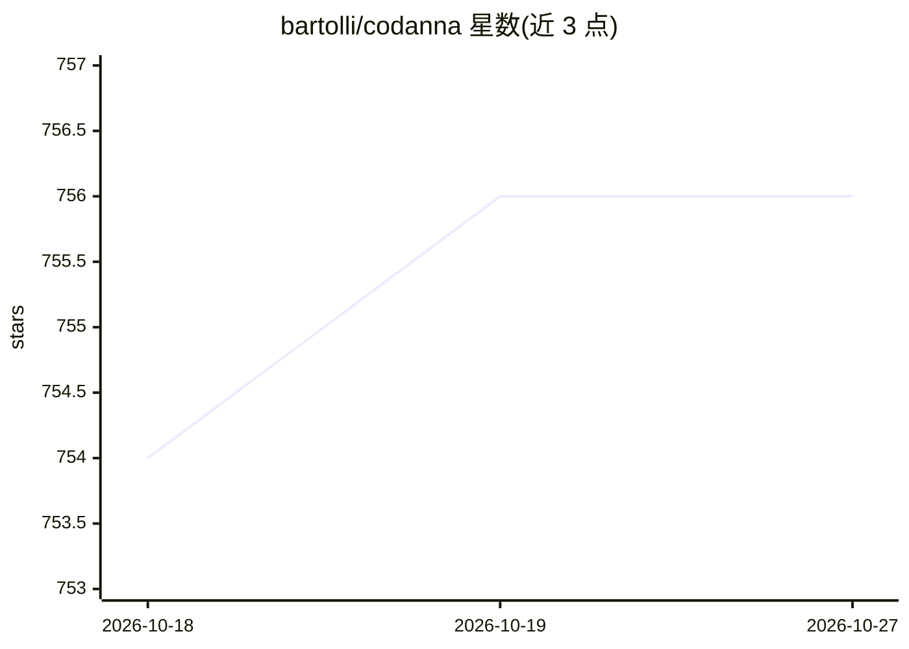

# bartolli/codanna

⭐ 756 · Rust · Apache-2.0 · 推送 2026-10-11 · [GitHub](https://github.com/bartolli/codanna) · [官网](https://docs.codanna.sh/) · 个人维护

**面向 AI 编码代理的本地代码智能 MCP 服务器与 CLI**

用 Rust 编写的本地代码索引与语义搜索 MCP 服务器，供 Claude Code、Cursor、Windsurf、Codex、Gemini 等 MCP 兼容客户端使用。它在磁盘上建立仓库索引（.codanna/），提供符号搜索、语义搜索、调用图、依赖追踪、文档 RAG 与影响分析；核心命令 semantic_search_with_context 将五类查询合并为一次调用。可作常驻 MCP 服务器（stdio/HTTP/HTTPS）或一次性 CLI 运行，支持 15 种语言，默认不向远程发送代码，嵌入模型本地运行，远程嵌入为可选项。Windows 支持处于实验阶段。

## 筛选速览

| 维度 | 判定 | 备注 |
|---|---|---|
| AI 角色 | `ai-ecosystem` | LLM/agent 周边工具 |
| 许可风险 | `permissive` | Apache-2.0 |
| 部署形态 | `library` | 以包/库形式分发 |
| 模型依赖 | — | README 未给出锁定关系 |
| 硬件要求 | — | 无带数字的原话,不猜 |
| 安装摩擦 | `medium` | 含编译或系统依赖之一 |
| 成熟度 | `idea` | |

## 能力要点

- 一次 MCP 调用返回符号上下文、调用图与影响分析
- 索引与嵌入模型均本地运行，源码默认不出机器
- 支持 15 种语言解析，预热后查询延迟 0.3-3 ms
- 提供常驻 MCP 服务器与一次性 CLI 两种模式，含 Claude Code 插件

## 适用场景

- 让编码代理获得代码库的结构化理解而非 grep 字符串匹配
- 查询函数被谁调用、改动会影响哪些代码
- 对项目文档建立索引供 RAG 检索

## 场景标签

`RAG` `语义搜索` · 领域:知识与检索

## 证据(README 行号)

> L15: **Local code intelligence MCP server and CLI for AI coding agents.**
> L23: It indexes your repository on disk and serves symbol search, semantic search, call graphs, dependency tracking, doc

## 星数曲线

2026-10-18 754 → 2026-10-27 756（+2）

---
*卡片 v1 · prompt 1.4 · 生成 2026-10-21 · 置信度 high · 依据 README sha `9794fcef4ed7` · [字段定义](../../DATASET.md)*
