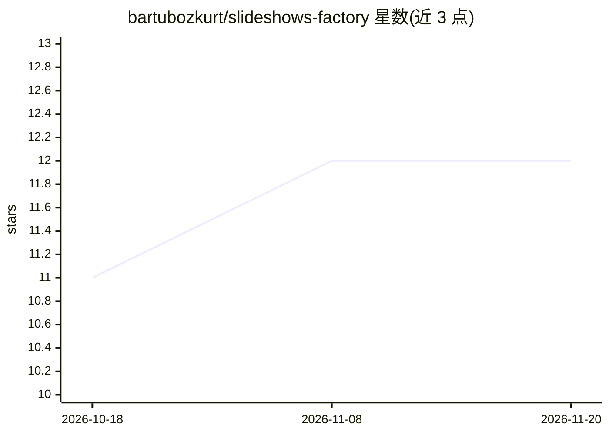

# bartubozkurt/slideshows-factory

⭐ 12 · 推送 2026-08-14 · [GitHub](https://github.com/bartubozkurt/slideshows-factory) · 个人维护

**营销创作者：把网站与爆款轮播截图转成自己的 hook 文案**

一个 Claude Code 工作区，无代码、无安装依赖，由 CLAUDE.md 与 .claude/skills/ 上下文文件构成。四条路由：读网站生成品牌简报（build-brand）、拆解他人 TikTok 轮播截图并产出 5 个 hook 与文案（swipe）、基于自有照片生成轮播脚本（photo-post）、批量生成创意脚本（make-slides）。内置 14 个 hook 公式、六维评分卡自审、禁用词表与禁止编造数据的护栏；输出仅文本，不生成图像。要求已安装并登录 Claude Code。

## 筛选速览

| 维度 | 判定 | 备注 |
|---|---|---|
| AI 角色 | `ai-native` | 本体是模型或模型工具 |
| 许可风险 | `none` | — |
| 部署形态 | `None` |  |
| 模型依赖 | — | README 未给出锁定关系 |
| 硬件要求 | — | 无带数字的原话,不猜 |
| 安装摩擦 | `low` | 无编译、无系统依赖或容器化 |
| 成熟度 | — | 结构信号不足 |

## 能力要点

- 四个技能自动路由：build-brand / swipe / photo-post / make-slides
- 14 个 hook 公式与 swipe-file.md 反馈飞轮，后续批次学习用户选择
- 护栏：hook ≤12 词、F06/F14 锁定至有真实数据来源、禁用词表、不生成图像
- scorecard.md 六维 PASS/WEAK/FAIL 自审后输出

## 适用场景

- 把自己的网站转成品牌简报和痛点库
- 拆解他人爆款轮播结构套用到自己的产品
- 基于自有照片批量产出 TikTok 轮播文案脚本

## 场景标签

`AI 写作` · 领域:内容生成

## 证据(README 行号)

> L3: A Claude Code workspace that turns your website into a brand brief, and screenshots of
> L10: There is no code here. No install, no dependencies, no build step. It's a set of context
> L55: |a screenshot of someone else's post|`swipe`|breakdown + 5 hooks + slide text + 3 captions|

## 星数曲线

2026-10-18 11 → 2026-11-20 12（+1）

---
*卡片 v1 · prompt 1.4 · 生成 2026-11-18 · 置信度 high · 依据 README sha `4f87b558b5e5` · [字段定义](../../DATASET.md)*
