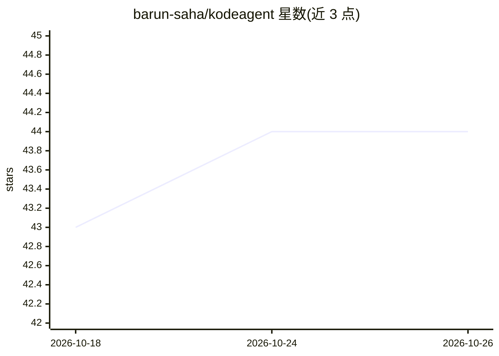

# barun-saha/kodeagent

⭐ 44 · Python · Apache-2.0 · 推送 2026-10-03 · [GitHub](https://github.com/barun-saha/kodeagent) · [官网](https://kodeagent.readthedocs.io/en/latest/) · 个人维护

**给开发者的极简 Python AI agent 引擎/构建框架**

KodeAgent 是一个基于 Python 3.10+ 的无框架式 AI agent 构建库，定位为嵌入更大系统中的推理核心而非完整平台。提供 ReActAgent、CodeActAgent、FunctionCallingAgent 三类 agent，支持 Planner 规划与内部 Observer 自检纠偏，FunctionCallingAgent 面向小语言模型优化并带重试逻辑。模型接入基于 LiteLLM，可在 Gemini/GPT/Claude/Ollama 间切换。工具即普通 Python 函数，内置 10 个工具；代码执行支持 host 与 E2B 沙箱两种环境。默认跨任务无记忆，支持 Recurrent 模式与手动注入 Chat History，不提供持久化层；可观测性经 Langfuse/LangSmith 集成。项目自称处于活跃开发期、能力有限。

## 筛选速览

| 维度 | 判定 | 备注 |
|---|---|---|
| AI 角色 | `ai-ecosystem` | LLM/agent 周边工具 |
| 许可风险 | `permissive` | Apache-2.0 |
| 部署形态 | `library` | 以包/库形式分发 |
| 模型依赖 | local-ok | 支持本地模型 |
| 硬件要求 | — | 无带数字的原话,不猜 |
| 安装摩擦 | `low` | 无编译、无系统依赖或容器化 |
| 成熟度 | `idea` | |

## 能力要点

- ReAct/CodeAct/Function Calling 三种 agent 范式开箱支持
- 基于 LiteLLM 的模型/提供商无关接入（Gemini/GPT/Claude/Ollama）
- Planner + 内部 Observer 的计划监控与纠偏机制
- 代码执行支持本机 host 与 E2B 沙箱两种环境

## 适用场景

- 在自己的应用中嵌入一个可执行代码、调用工具的 agent 推理核心
- 在函数调用能力有限的小语言模型上构建 agent
- 在 serverless 环境以少量依赖运行轻量 agent

## 场景标签

`Agent 框架` · 领域:Agent 开发

## 证据(README 行号)

> L18: KodeAgent is a frameworkless, minimalistic approach to building AI agents. KodeAgent is designed to be the robust r
> L27: - **ReAct, CodeAct, and Function Calling:** KodeAgent supports ReAct, CodeAct, and native Function Calling paradigm
> L31: - **LLM Agnostic:** Built on LiteLLM, KodeAgent easily swaps between models (e.g., Gemini, GPT, and Claude) and pro

## 星数曲线

2026-10-18 43 → 2026-10-26 44（+1）

---
*卡片 v1 · prompt 1.4 · 生成 2026-10-25 · 置信度 high · 依据 README sha `b293e096c047` · [字段定义](../../DATASET.md)*
