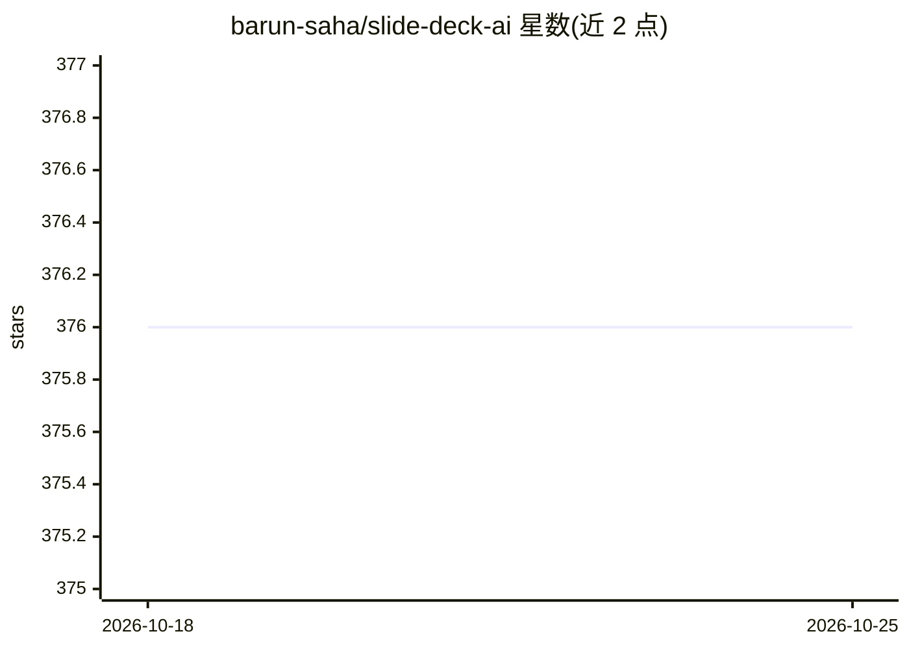

# barun-saha/slide-deck-ai

⭐ 376 · Python · MIT · 推送 2026-10-03 · [GitHub](https://github.com/barun-saha/slide-deck-ai) · [官网](https://barunsaha-slide-deck-ai.hf.space/) · 个人维护

**面向演示者的 AI 助手：根据主题生成 PowerPoint 幻灯片**

SlideDeck AI 是用 LLM 生成 PowerPoint 演示文稿的工具：用户提供主题描述，LLM 按预定义 schema 生成结构化 JSON 内容，随后搜索下载图片并用 python-pptx 组装成 PPTX，可从预定义模板中选择样式，支持后续指令迭代修改，也可基于 PDF 文件生成演示。支持多家在线 LLM（OpenAI、Google Gemini、Anthropic、Azure OpenAI、Cohere、OpenRouter、SambaNova、Together AI），并可通过 Ollama 使用离线模型。以 Python API、CLI（slidedeckai generate/launch）和 Streamlit 应用三种形式提供，需用户提供 API key（MIT 许可，Python 3.10+）。

## 筛选速览

| 维度 | 判定 | 备注 |
|---|---|---|
| AI 角色 | `ai-native` | 本体是模型或模型工具 |
| 许可风险 | `permissive` | MIT |
| 部署形态 | `library` | 以包/库形式分发 |
| 模型依赖 | local-ok | 支持本地模型 |
| 硬件要求 | — | 无带数字的原话,不猜 |
| 安装摩擦 | `low` | 无编译、无系统依赖或容器化 |
| 成熟度 | — | 结构信号不足 |

## 能力要点

- LLM 生成结构化 JSON 内容，python-pptx 组装为可下载 PPTX
- 支持 10+ 家在线 LLM 提供商及 Ollama 离线模型
- 指令式迭代修改（新增/修改幻灯片，保留指令历史）
- 支持基于 PDF 文件生成演示文稿

## 适用场景

- 输入主题快速生成一套 PowerPoint 幻灯片初稿
- 把 PDF 文档转换成演示文稿
- 隐私敏感场景下用 Ollama 本地模型离线生成内容

## 场景标签

`AI 助手` · 领域:对话与助手

## 证据(README 行号)

> L22: **SlideDeck AI is your powerful AI assistant** for presentation generation. Co-create stunning, professional slide 
> L32: 1. **AI Content Generation:** Given a topic description, a Large Language Model (LLM) generates the *initial* slide

## 星数曲线

2026-10-18 376 → 2026-10-25 376（+0）

---
*卡片 v1 · prompt 1.4 · 生成 2026-10-21 · 置信度 high · 依据 README sha `ff970a073b5e` · [字段定义](../../DATASET.md)*
