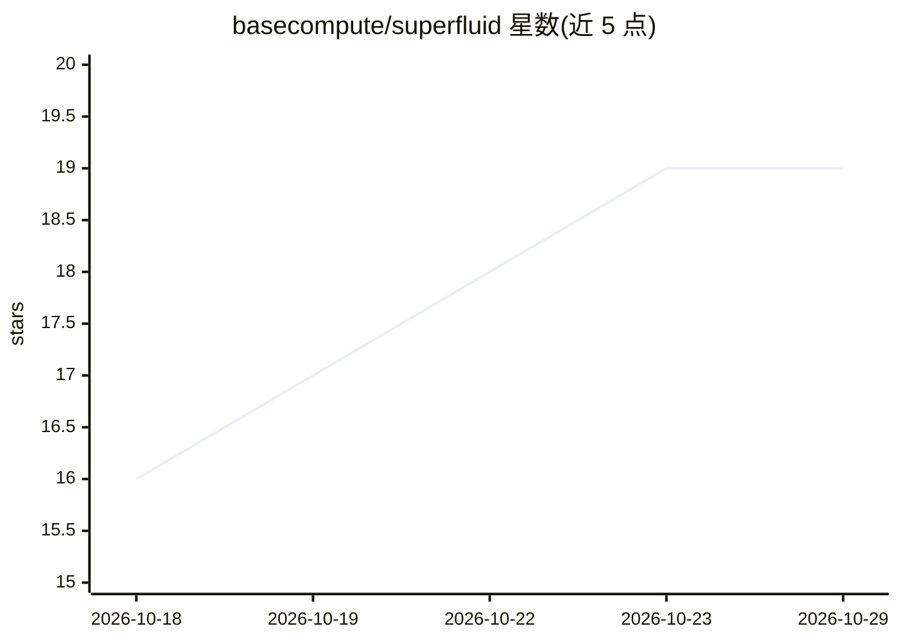

# basecompute/superfluid

⭐ 19 · Rust · Apache-2.0 · 推送 2026-10-27 · [GitHub](https://github.com/basecompute/superfluid) · [官网](https://superfluid.sh) · 组织维护

**本地 LLM 推理服务守护进程：统一调度多运行时多机器**

在 llama.cpp、MLX 与 baseRT 之上提供单一服务层：一个调度器、一份持久会话日志（写前日志）与一套 API，OpenAI/Anthropic/Ollama 客户端可不改代码接入。特性包括交互请求抢占批处理、崩溃后从日志恢复会话、共享前缀只做一次 prefill；支持多机组建节点（本地网络自动发现、加密链路）。运行时按需从各自 release 安装，不 vendor 或链接任何运行时。项目声明 pre-1.0，接口与磁盘格式可能变更。

## 筛选速览

| 维度 | 判定 | 备注 |
|---|---|---|
| AI 角色 | `ai-ecosystem` | LLM/agent 周边工具 |
| 许可风险 | `permissive` | Apache-2.0 |
| 部署形态 | `None` |  |
| 模型依赖 | local-ok | 支持本地模型 |
| 硬件要求 | — | 无带数字的原话,不猜 |
| 安装摩擦 | `low` | 无编译、无系统依赖或容器化 |
| 成熟度 | `idea` | |

## 能力要点

- OpenAI/Anthropic/Ollama 三种 API 兼容，客户端无需改动
- 写前日志使会话在 worker 崩溃或服务器重启后可恢复
- 32 个请求共享同一 5k 前缀只做约一次 prefill
- 多机节点加入：本地网络自动发现头部节点，链路加密

## 适用场景

- 多个编码 agent 共用一台机器跑本地模型且互不干扰
- 让 Claude Code 等 coding agent 使用本地推理服务
- 把多台机器（含 Apple silicon）组成一个本地推理集群

## 场景标签

`推理引擎` · 领域:训练与推理

## 证据(README 行号)

> L7: superfluid puts one scheduler, one durable session log and one set of APIs in front of llama.cpp, MLX and baseRT. Se
> L59:  Coding agents and any OpenAI, Anthropic or Ollama client reach one superfluid server, which drives baseRT, llama.c
> L63: |runtime|serves|comes from|

## 星数曲线

2026-10-18 16 → 2026-10-29 19（+3）

---
*卡片 v1 · prompt 1.4 · 生成 2026-10-28 · 置信度 high · 依据 README sha `757f4da7fa09` · [字段定义](../../DATASET.md)*
