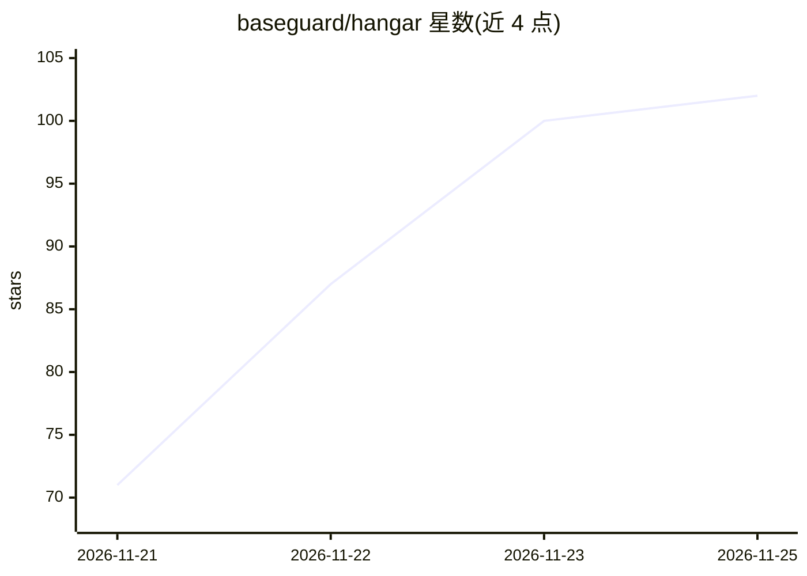

# baseguard/hangar

⭐ 102 · Swift · Apache-2.0 · 推送 2026-11-20 · [GitHub](https://github.com/baseguard/hangar) · [官网](https://hangar.bot) · 组织维护

**在 Mac 虚拟机中隔离运行 AI 编码 agent 的沙箱工具**

Hangar 在 Mac 上以虚拟机方式运行 AI 编码 agent，提供 macOS/Linux/Windows 三种 VM 镜像。核心机制：限制 VM 只能访问用户允许的网站并记录全部连接；API 密钥存于 Mac Keychain，VM 内只见假值、出站时替换；快照一键还原；可从快照克隆多个 VM 并行运行 agent；附带 MCP 服务器让 Claude Code/Codex 创建与管理 VM。限制：新 VM 默认不拦截连接、HTTPS 只能看到站点名。以 Mac 应用和 hangar 命令行提供，Apache 2.0。

## 筛选速览

| 维度 | 判定 | 备注 |
|---|---|---|
| AI 角色 | `ai-ecosystem` | LLM/agent 周边工具 |
| 许可风险 | `permissive` | Apache-2.0 |
| 部署形态 | `library` | 以包/库形式分发 |
| 模型依赖 | — | README 未给出锁定关系 |
| 硬件要求 | — | 无带数字的原话,不猜 |
| 安装摩擦 | `low` | 无编译、无系统依赖或容器化 |
| 成熟度 | — | 结构信号不足 |

## 能力要点

- VM 网络连接全程在 Mac 侧记录，VM 内无法关闭
- API 密钥存于 Keychain，VM 内环境变量为假值，出站时替换
- 快照即时保存/还原，可克隆多 VM 并行运行 agent
- hangar mcp 作为 MCP 服务器，让 agent 创建/启动 VM、执行命令

## 适用场景

- 关闭审批模式运行 Claude Code/Codex 而不暴露本机文件与密钥
- 用允许列表限制 agent 可访问的网站并审计流量
- 为不受信任的 agent 准备可随时还原的隔离环境
- 并行运行多个 agent 各自独立 VM

## 场景标签

`编码 Agent` `网络安全` · 领域:编码与开发

## 证据(README 行号)

> L5:  Run AI coding agents in a macOS, Linux or Windows virtual machine on your Mac.
> L19: before every command. But then they can do anything on your computer. Hangar runs the agent in its own virtual
> L143: `hangar mcp` is an MCP server. Add it to Claude Code or Codex on your Mac:

## 星数曲线

2026-11-21 71 → 2026-11-25 102（+31）

---
*卡片 v1 · prompt 1.4 · 生成 2026-11-21 · 置信度 high · 依据 README sha `389fcfd34785` · [字段定义](../../DATASET.md)*
