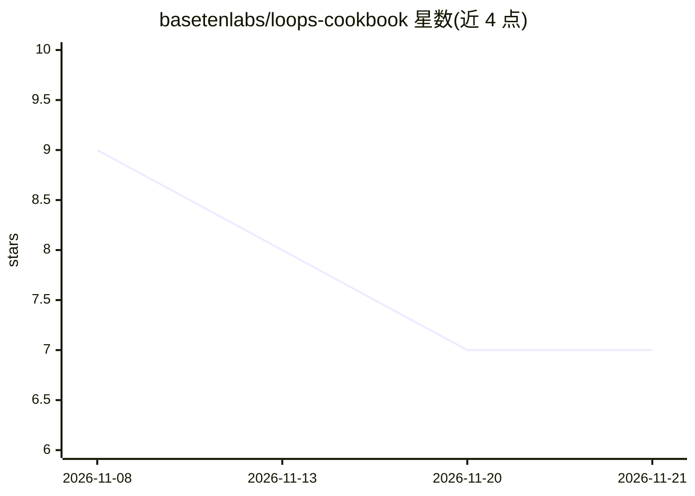

# basetenlabs/loops-cookbook

⭐ 7 · Python · MIT · 推送 2026-11-20 · [GitHub](https://github.com/basetenlabs/loops-cookbook) · [官网](https://docs.baseten.co/loops/overview) · 组织维护

**面向 Baseten Loops 用户的 RL/SFT 后训练模板与配方集**

基于 baseten-loops SDK 的后训练模板库：为 Baseten Loops 用户提供可直接复制的强化学习（RLVR、LLM judge、异步调度）与监督微调（SFT）示例，覆盖工具调用 agent、Terminal-Bench 等真实基准。Loops 云端负责 GPU 训练 LoRA 适配器并从 sampler 提供服务，cookbook 在本地运行 agent、记录 token、评分并提交训练批次；用 GRPO 计算优势，TOML 配置定义任务，loops 命令负责校验/运行/清理。使用需有启用 Loops 的 Baseten 工作区及 API key，运行产生计费资源。

## 筛选速览

| 维度 | 判定 | 备注 |
|---|---|---|
| AI 角色 | `ai-ecosystem` | LLM/agent 周边工具 |
| 许可风险 | `permissive` | MIT |
| 部署形态 | `library` | 以包/库形式分发 |
| 模型依赖 | — | README 未给出锁定关系 |
| 硬件要求 | — | 无带数字的原话,不猜 |
| 安装摩擦 | `low` | 无编译、无系统依赖或容器化 |
| 成熟度 | — | 结构信号不足 |

## 能力要点

- 13 个 RL/SFT 模板目录，均可开箱运行后再修改
- GRPO 优势计算、episode 调度、checkpoint 与指标管理由 cookbook 承担
- TOML 训练配置区分 serverless 与 dedicated 计算模式
- loops check/run/cleanup 命令行工具链

## 适用场景

- 用可验证奖励（RLVR）对模型做强化学习后训练
- 在真实基准（如 Terminal-Bench）上训练编码 agent
- 把 Hugging Face 对话数据微调成支持工具调用的模型

## 场景标签

`教程课程` `强化学习` `微调` · 领域:学习与行业

## 证据(README 行号)

> L16: The Loops Cookbook is a starting point for post-training models on
> L81: or asynchronously. It computes advantages with group relative policy optimization
> L82: (GRPO), which scores each attempt against the mean reward of its group. It also manages

## 星数曲线

2026-11-08 9 → 2026-11-21 7（-2）

---
*卡片 v1 · prompt 1.4 · 生成 2026-11-20 · 置信度 high · 依据 README sha `3f49bdf173de` · [字段定义](../../DATASET.md)*
