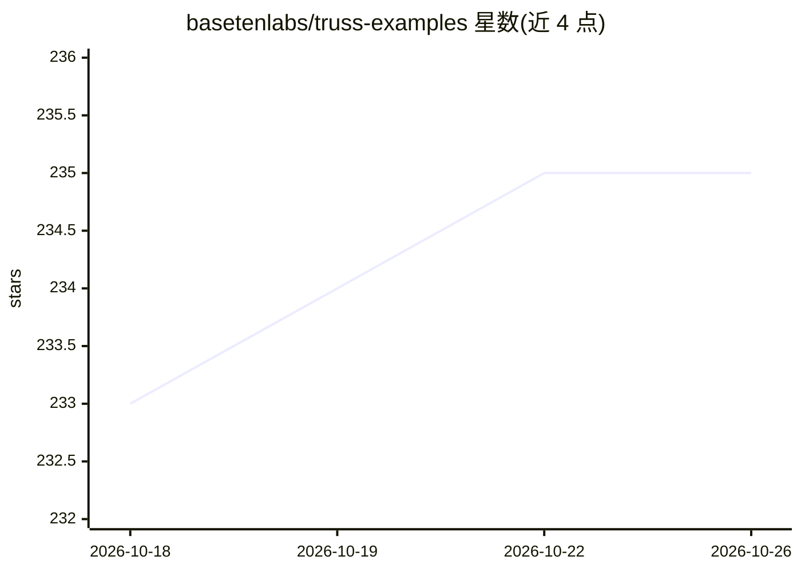

# basetenlabs/truss-examples

⭐ 235 · Python · MIT · 推送 2026-10-25 · [GitHub](https://github.com/basetenlabs/truss-examples) · [官网](https://trussml.com) · 组织维护

**Truss 模型部署示例集：数十个可直接部署的示例**

Baseten 维护的 Truss 部署示例仓库，收录数十个示例模型，可原样部署或修改适配。使用方式：git clone 获取仓库、pip 安装 Truss，通过 truss push 命令指定模型目录（如 02-llm）部署，需 Baseten API Key。涵盖 LLM 与嵌入/重排序类示例（EmbeddingGemma、Laya、Rune 26B、Qwen3 embeddings、ModernBERT reranking 等），各模型的调用方式见其单独 README。

## 筛选速览

| 维度 | 判定 | 备注 |
|---|---|---|
| AI 角色 | `ai-ecosystem` | LLM/agent 周边工具 |
| 许可风险 | `permissive` | MIT |
| 部署形态 | `library` | 以包/库形式分发 |
| 模型依赖 | — | README 未给出锁定关系 |
| 硬件要求 | — | 无带数字的原话,不猜 |
| 安装摩擦 | `low` | 无编译、无系统依赖或容器化 |
| 成熟度 | — | 结构信号不足 |

## 能力要点

- 数十个示例模型，可原样部署或修改适配
- truss push 命令行部署流程
- 涵盖嵌入与重排序类示例（EmbeddingGemma/Qwen3/ModernBERT 等）

## 适用场景

- 学习如何用 Truss 打包部署 AI/ML 模型
- 以现成示例为基础快速部署自己的模型
- 参考嵌入与重排序模型的部署配置

## 场景标签

`MLOps` `教程课程` · 领域:学习与行业

## 证据(README 行号)

> L5: Truss is the simplest way to serve AI/ML models in production.
> L7: To get you started with Truss, this repository has dozens of example models, each ready to deploy as-is or adapt to 

## 星数曲线

2026-10-18 233 → 2026-10-26 235（+2）

---
*卡片 v1 · prompt 1.4 · 生成 2026-10-22 · 置信度 mid · 依据 README sha `76c4bc0e69e9` · [字段定义](../../DATASET.md)*
