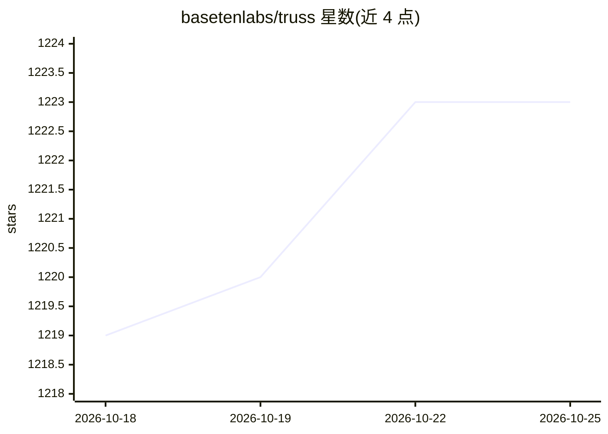

# basetenlabs/truss

⭐ 1,223 · Python · MIT · 推送 2026-10-24 · [GitHub](https://github.com/basetenlabs/truss) · [官网](https://truss.baseten.co) · 组织维护

**部署 ML 模型到生产的 CLI：打包、容器化与 GPU 配置**

Baseten 维护的模型部署命令行工具：将模型的 Python 服务逻辑、权重与依赖打包为容器，处理容器化、依赖管理与 GPU 配置，部署到 Baseten 平台或自有基础设施。支持 vLLM、SGLang、TensorRT-LLM、transformers、diffusers、PyTorch、TensorFlow 等框架的模型。基于引擎的部署可仅用 config.yaml 声明模型、硬件与引擎，产出 OpenAI 兼容 API 端点；也支持自定义 Python 代码路径，并提供 config.yaml 的 JSON schema 与编辑器补全。

## 筛选速览

| 维度 | 判定 | 备注 |
|---|---|---|
| AI 角色 | `ai-ecosystem` | LLM/agent 周边工具 |
| 许可风险 | `permissive` | MIT |
| 部署形态 | `self-host` | docker 或自建部署 |
| 模型依赖 | local-ok | 支持本地模型 |
| 硬件要求 | — | 无带数字的原话,不猜 |
| 安装摩擦 | `low` | 无编译、无系统依赖或容器化 |
| 成熟度 | — | 结构信号不足 |

## 能力要点

- 以 config.yaml 声明式部署模型，无需 Dockerfile 与容器管理
- 支持 vLLM、SGLang、TensorRT-LLM、transformers 等框架的模型服务
- 部署产出 OpenAI 兼容 API 端点，可直接用 OpenAI SDK 调用
- 提供 config.yaml JSON schema，编辑器内自动补全与校验

## 适用场景

- 把 Hugging Face 模型部署成生产 API 端点
- 在开发和生产间以同一打包方式迭代模型服务
- 用声明式配置指定 GPU 与 TensorRT-LLM 引擎部署 LLM

## 场景标签

`推理引擎` · 领域:训练与推理

## 证据(README 行号)

> L9: Truss is the CLI for deploying and serving ML models on Baseten. Package your model's serving logic in Python, launc
> L11: Truss lets you serve models with the Baseten Inference Stack as well as deploy models from any open-source framewor

## 星数曲线

2026-10-18 1,219 → 2026-10-25 1,223（+4）

---
*卡片 v1 · prompt 1.4 · 生成 2026-10-21 · 置信度 mid · 依据 README sha `71c1336203bf` · [字段定义](../../DATASET.md)*
