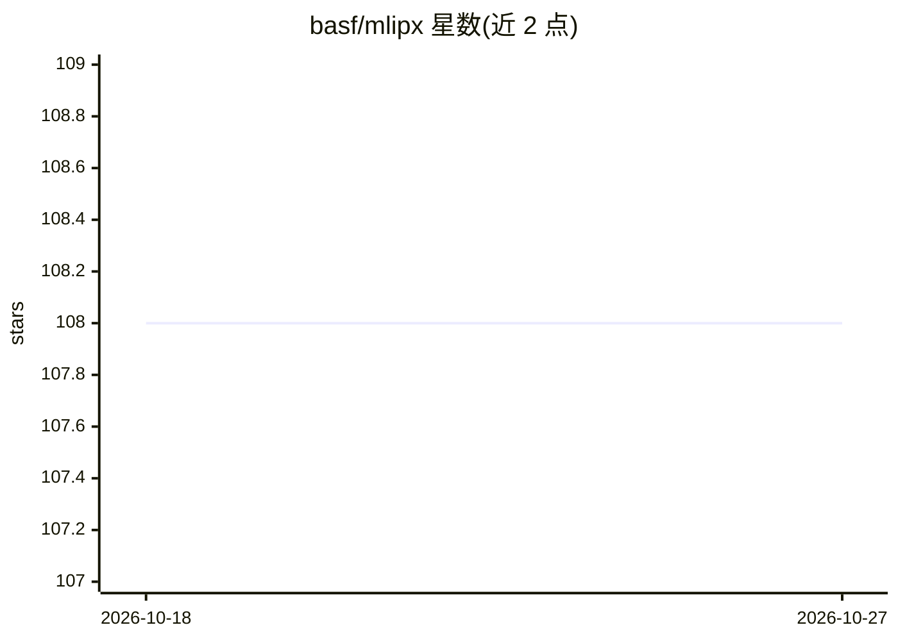

# basf/mlipx

⭐ 108 · Python · MIT · 推送 2026-01-28 · [GitHub](https://github.com/basf/mlipx) · [官网](https://mlipx.readthedocs.io) · 组织维护

**机器学习原子间势（MLIP）评测与对比库，面向材料模拟科研**

BASF 开发的 Python 库，用于评测机器学习原子间势（MLIP）：内置能量-体积曲线、结构优化、NEB 过渡态计算等 recipes，通过 CLI 或 Python API 运行，支持 mace-mpa-0、sevennet、orb-v2 等模型预设及任意 ASE 兼容 calculator。基于 Git+DVC+ZnTrack 实现实验可复现与缓存，结果可用 ZnDraw 可视化并在多模型间对比。包本身不捆绑 MLIP 依赖，需手动安装；运行前须在 Git/DVC 项目目录中初始化。

## 筛选速览

| 维度 | 判定 | 备注 |
|---|---|---|
| AI 角色 | `ai-ecosystem` | LLM/agent 周边工具 |
| 许可风险 | `permissive` | MIT |
| 部署形态 | `library` | 以包/库形式分发 |
| 模型依赖 | — | README 未给出锁定关系 |
| 硬件要求 | — | 无带数字的原话,不猜 |
| 安装摩擦 | `low` | 无编译、无系统依赖或容器化 |
| 成熟度 | — | 结构信号不足 |

## 能力要点

- 内置 EV 曲线、结构优化、NEB 等 MLIP 评测 recipes
- 支持 mace-mpa-0/sevennet/orb-v2 预设及任意 ASE 兼容 calculator
- 基于 Git+DVC+ZnTrack 的可复现实验管理与缓存
- CLI 与 Python API 双入口，ZnDraw 结果可视化与多模型对比

## 适用场景

- 我想比较多个 MLIP 在自己体系上的适用性再选型
- 批量运行能量-体积曲线/NEB 等标准评测并可视化对比
- 在课题组内以可复现方式共享 MLIP 评测结果

## 场景标签

`模型评测` `科研工具` · 领域:评测与运维

## 证据(README 行号)

> L18: `mlipx` is a Python library designed for evaluating machine-learned interatomic
> L22: The goal of `mlipx` is to provide a common platform for MLIP evaluation and to
> L23: facilitate sharing results among researchers. This allows you to determine the

## 星数曲线

2026-10-18 108 → 2026-10-27 108（+0）

---
*卡片 v1 · prompt 1.4 · 生成 2026-10-23 · 置信度 high · 依据 README sha `2b1b9565268a` · [字段定义](../../DATASET.md)*
