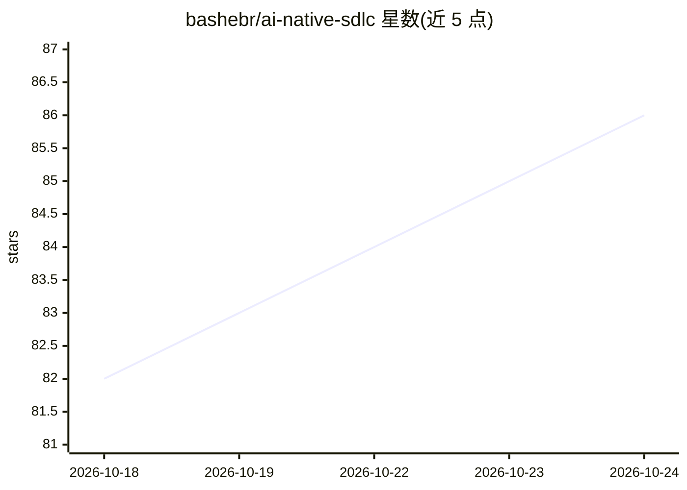

# bashebr/ai-native-sdlc

⭐ 87 · Python · MIT · 推送 2026-10-10 · [GitHub](https://github.com/bashebr/ai-native-sdlc) · 个人维护

**给编码 Agent 的 AI-Native SDLC 工作流技能与插件**

实现 Anthropic AI-Native SDLC playbook 的可复用工作流仓库，同一份技能文件夹可分别安装为 Codex skill（~/.codex/skills）或 Claude Code skill（~/.claude/skills），也可作为 Codex plugin 发布。工作流为 Plan→Design→Build→Test→Deploy→Maintain 有向图循环，每阶段提交版本化产物，人工审批集中在各阶段交接的 gate，代理可推进到生产 gate 但不越过。附带脚手架脚本（init_workflow.py/init_org.py）、自治 agent 组织（CEO 人工 + CTO 代理等多角色）、hooks 护栏（production-gate.sh、scan_secrets.py）、控制带监控与 CI evals 示例。MIT 许可，基于 Anthropic Applied AI 团队 2026 年 playbook。

## 筛选速览

| 维度 | 判定 | 备注 |
|---|---|---|
| AI 角色 | `ai-ecosystem` | LLM/agent 周边工具 |
| 许可风险 | `permissive` | MIT |
| 部署形态 | `None` |  |
| 模型依赖 | — | README 未给出锁定关系 |
| 硬件要求 | — | 无带数字的原话,不猜 |
| 安装摩擦 | `low` | 无编译、无系统依赖或容器化 |
| 成熟度 | — | 结构信号不足 |

## 能力要点

- 同一技能文件夹支持安装为 Codex skill、Claude Code skill 或 Codex plugin 三种形态
- 每阶段提交版本化产物（intent.md/spec.md/plan.md），人工审批集中在 gate
- 自治 agent 组织脚手架：CTO/产品经理/工程师/审查者角色与多渠道需求收集
- 确定性 hooks 护栏：生产 gate 阻止未授权部署、secrets 扫描阻止凭证入库

## 适用场景

- 让编码 agent 按完整 SDLC 循环驱动项目并在各 gate 等待人工批准
- 团队以 fork/继承方式定制自己的 agent 工作流基线
- 在已有项目中引入意图→规格→计划→构建的产物化模板

## 场景标签

`工作流自动化` `编码 Agent` · 领域:效率与自动化

## 证据(README 行号)

> L9: - A **Codex skill** at `skills/ai-native-sdlc/`, installable into `~/.codex/skills`.
> L10: - A **Claude Code skill** — the same folder, installable into `~/.claude/skills`.
> L41: **Framework mapping.** The skill is framework-neutral: Claude Code calls repository memory CLAUDE.md and keeps skil

## 星数曲线

2026-10-18 82 → 2026-10-24 86（+4）

---
*卡片 v1 · prompt 1.4 · 生成 2026-10-24 · 置信度 high · 依据 README sha `e1340d2dfc85` · [字段定义](../../DATASET.md)*
