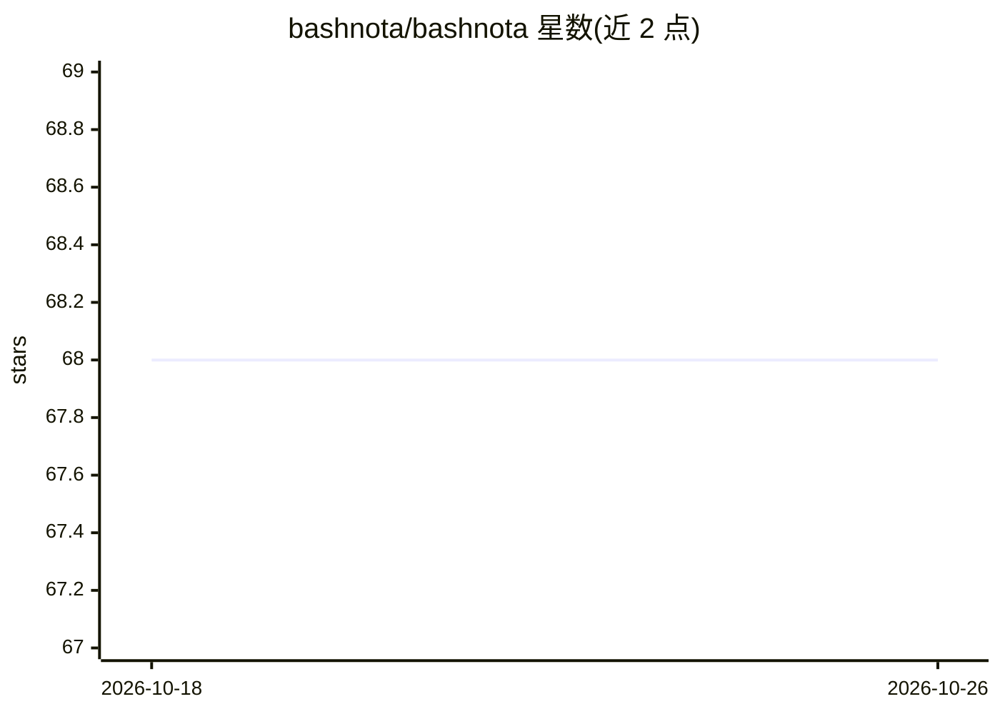

# bashnota/bashnota

⭐ 68 · TypeScript · AGPL-3.0 · 推送 2026-10-05 · [GitHub](https://github.com/bashnota/bashnota) · [官网](https://www.bashnota.com/) · 个人维护

**带 AI 助手与代码执行的富文本笔记应用**

基于 Vue 3 + TipTap 的 Web 笔记应用，定位为 Jupyter Notebook 的替代品：富文本编辑中嵌入可执行的 Python/JavaScript 代码块，通过 Jupyter 协议本地运行；集成 AI 助手（OpenAI/Gemini/Claude），支持 LaTeX、Mermaid 图表、双存储模式（IndexedDB 或文件系统 .nota 文件）。后端使用 Supabase（Auth/Postgres/Storage），部署目标为 GitHub Pages 或 Coolify Docker 容器。文件系统模式的外部编辑监视为实验性，建议独立备份。

## 筛选速览

| 维度 | 判定 | 备注 |
|---|---|---|
| AI 角色 | `ai-enhanced` | 去掉 AI 部分产品仍成立 |
| 许可风险 | `viral` | AGPL-3.0 |
| 部署形态 | `self-host` | docker 或自建部署 |
| 模型依赖 | — | README 未给出锁定关系 |
| 硬件要求 | — | 无带数字的原话,不猜 |
| 安装摩擦 | `low` | 无编译、无系统依赖或容器化 |
| 成熟度 | `idea` | |

## 能力要点

- 富文本编辑中执行 Python/JavaScript 代码块（Jupyter 协议）
- AI 助手集成 OpenAI/Gemini/Claude
- 双存储模式：IndexedDB 或文件系统 .nota 文件（可与 git 配合）
- PWA 生产镜像由 Nginx 服务，支持 Coolify 部署

## 适用场景

- 在笔记中直接运行并记录代码，做研究式记录
- 用 AI 助手辅助笔记与代码工作
- 本地或自托管部署个人知识/笔记工作区

## 场景标签

`知识库管理` · 领域:知识与检索

## 证据(README 行号)

> L13: BashNota combines rich text editing with executable code blocks, AI assistance, and seamless organization. Built fo
> L17: - 💻 Execute Python/JavaScript code blocks
> L18: - 🤖 AI assistant integration

## 星数曲线

2026-10-18 68 → 2026-10-26 68（+0）

---
*卡片 v1 · prompt 1.4 · 生成 2026-10-24 · 置信度 low · 依据 README sha `63cf99554847` · [字段定义](../../DATASET.md)*
