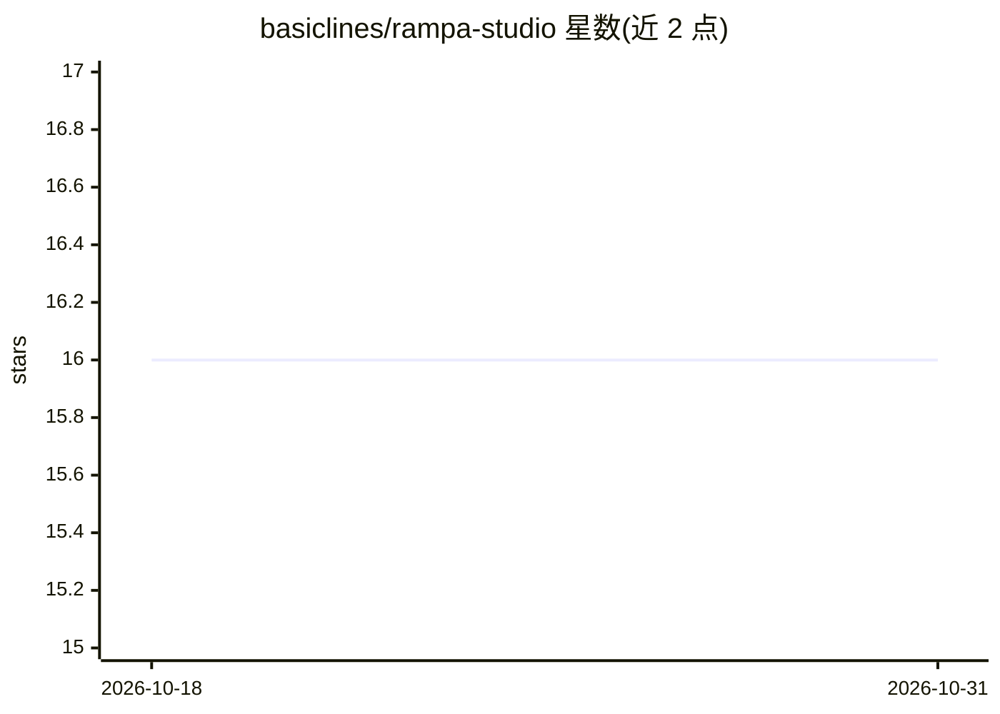

# basiclines/rampa-studio

⭐ 16 · TypeScript · MIT · 推送 2026-03-20 · [GitHub](https://github.com/basiclines/rampa-studio) · [官网](https://rampa.design) · 个人维护

**面向 AI agent 与设计者的 OKLCH 色板生成工具箱**

基于 OKLCH 色彩空间生成感知均匀色板的工具集，同一色彩引擎贯穿三种形态：CLI（可全局安装或下载二进制）、JavaScript SDK（npm 包及浏览器 CDN bundle）与网页编辑器 rampa.studio。配置以色板级别参数进行：亮度/饱和度/色相的起止区间、11 种分布尺度、7 类色彩和声、16 种混合模式的着色系统，并提供 APCA 对比度 lint。另含面向 AI 编码助手的 7 个 Agent Skills，可经 npx skills 安装。许可对个人与开发者免费，商用集成需另行授权。

## 筛选速览

| 维度 | 判定 | 备注 |
|---|---|---|
| AI 角色 | `ai-enhanced` | 去掉 AI 部分产品仍成立 |
| 许可风险 | `permissive` | MIT |
| 部署形态 | `desktop` | 安装包/桌面程序 |
| 模型依赖 | — | README 未给出锁定关系 |
| 硬件要求 | — | 无带数字的原话,不猜 |
| 安装摩擦 | `low` | 无编译、无系统依赖或容器化 |
| 成熟度 | — | 结构信号不足 |

## 能力要点

- OKLCH 色彩空间生成感知均匀色板，CLI/SDK/Web 共享同一引擎
- 11 种分布尺度与 7 类色彩和声、16 种混合模式着色
- APCA 对比度分析与 WCAG 前景/背景 lint
- 7 个可安装到 AI 编码助手的 Agent Skills

## 适用场景

- 从品牌主色生成主题色板与状态色（成功/警告/危险）
- 为图表选择可区分的数据可视化配色
- 在脚本或 CI/CD 中以命令行生成并导出 CSS 变量
- 让 AI 编码助手通过技能自动完成配色任务

## 场景标签

 · 领域:设计/前端工具

## 证据(README 行号)

> L3: Generate mathematically accurate, accessible color palettes from a base color using the OKLCH color space. Available
> L146: ## 🤖 Agent Skills
> L153: npx skills add basiclines/rampa-studio

## 星数曲线

2026-10-18 16 → 2026-10-31 16（+0）

---
*卡片 v1 · prompt 1.4 · 生成 2026-10-30 · 置信度 high · 依据 README sha `f046da33d25a` · [字段定义](../../DATASET.md)*
