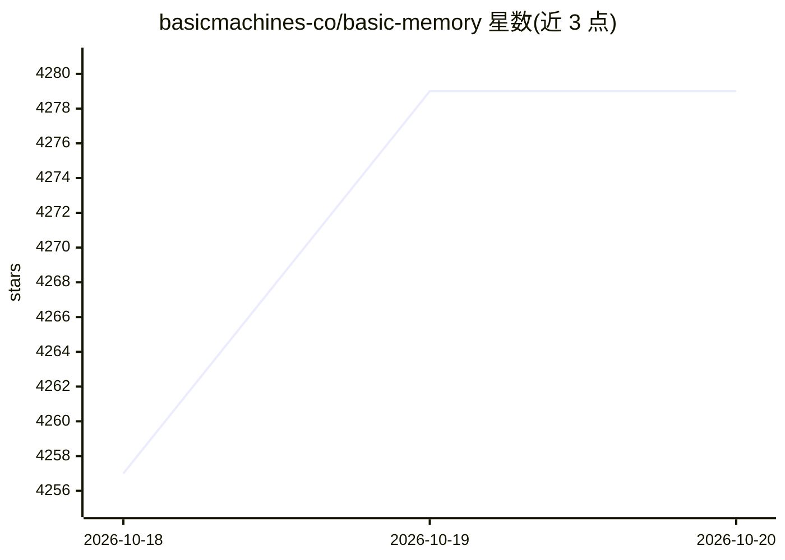

# basicmachines-co/basic-memory

⭐ 4,279 · Python · AGPL-3.0 · 推送 2026-10-19 · [GitHub](https://github.com/basicmachines-co/basic-memory) · [官网](https://basicmemory.com) · 组织维护

**给 AI 客户端的本地优先 Markdown 知识记忆 MCP 服务器**

以 MCP 服务器形式为 Claude、Codex、Cursor、ChatGPT 等 AI 客户端提供持久知识记忆：笔记以纯 Markdown 存储在本地磁盘，人与 AI 双向读写同一批文件，观察与 wikilink 构成知识图谱，支持语义检索与可选的 cross-encoder 重排。本地安装需 Python 3.12+ 与 uv，另有 $15/月的托管云版本（同一引擎，AGPL-3.0 开源），云端经 WorkOS/Neon/Tigris 构建。仓库同时发布 Claude Code 插件、共享 SKILL.md 技能、Hermes 与 OpenClaw 插件。

## 筛选速览

| 维度 | 判定 | 备注 |
|---|---|---|
| AI 角色 | `ai-ecosystem` | LLM/agent 周边工具 |
| 许可风险 | `viral` | AGPL-3.0 |
| 部署形态 | `library` | 以包/库形式分发 |
| 模型依赖 | locked-api |  |
| 硬件要求 | — | 无带数字的原话,不猜 |
| 安装摩擦 | `low` | 无编译、无系统依赖或容器化 |
| 成熟度 | — | 结构信号不足 |

## 能力要点

- Markdown 本地存储，人与 AI 双向读写、同步保持一致
- MCP-native，提供 Claude Desktop/Claude Code/Codex/Cursor/VS Code/ChatGPT 等接入配置
- 语义检索 + 可选 cross-encoder 重排（本地 FastEmbed 或 LiteLLM 托管）
- 官方 agent 包：Claude Code 插件、SKILL.md 技能、Hermes/OpenClaw 插件同源发布

## 适用场景

- 让 Claude/Codex/Cursor 等记住项目上下文，不必重复解释
- 在 Obsidian 中直接查看与编辑 AI 写入的知识库
- 本地/离线环境（air-gapped）下管理 AI 可访问的笔记

## 场景标签

`知识库管理` `知识图谱` `语义搜索` `Agent 记忆` · 领域:Agent 开发

## 证据(README 行号)

> L30: Pick up right where you left off — in Claude, Codex, Cursor, ChatGPT, or
> L40: - **MCP-native.** Works with every major AI client and IDE.
> L175: |Anything MCP|stdio/https|If it speaks MCP, it works|

## 星数曲线

2026-10-18 4,257 → 2026-10-20 4,279（+22）

---
*卡片 v1 · prompt 1.4 · 生成 2026-10-20 · 置信度 mid · 依据 README sha `90cb1742f6b9` · [字段定义](../../DATASET.md)*
