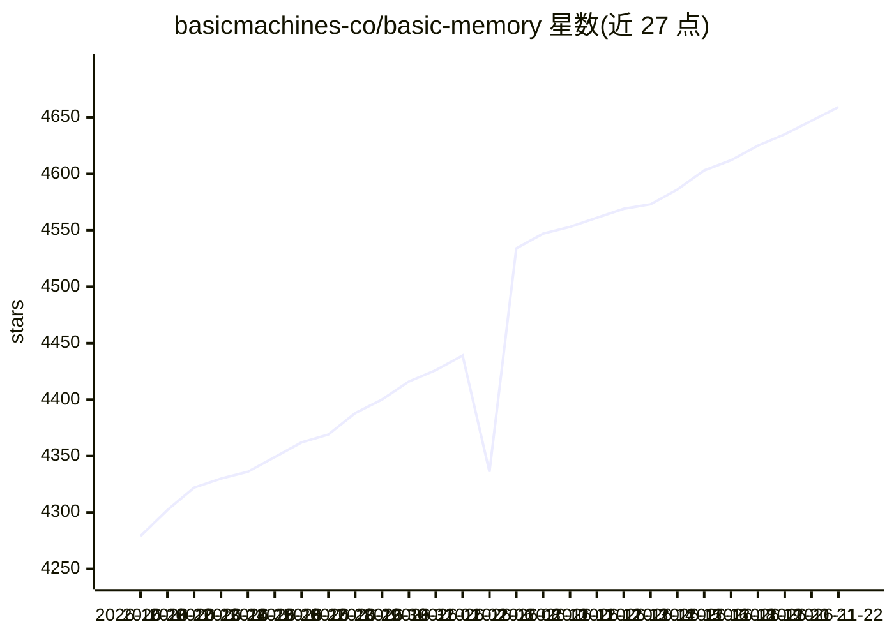

# basicmachines-co/basic-memory

⭐ 4,659 · Python · AGPL-3.0 · 推送 2026-11-20 · [GitHub](https://github.com/basicmachines-co/basic-memory) · [官网](https://basicmemory.com) · 组织维护

**给 AI 客户端提供本地 Markdown 知识库记忆的 MCP 服务器**

以 MCP 服务器形式运行的知识管理工具：把 AI 与人的笔记存为本地 Markdown 文件，通过 observations 与 wikilinks 构建知识图谱，提供语义检索（可选 cross-encoder 重排）与双向同步。本地版基于 Python/uv 安装、AGPL-3.0、数据存于本机磁盘；另提供收费云托管版（$15/mo）与 Teams 共享工作区。可接入 Claude Desktop、Claude Code、Codex、Cursor、VS Code、ChatGPT 等任何支持 MCP 的客户端，Obsidian 可直接读写同一批 Markdown 文件。

## 筛选速览

| 维度 | 判定 | 备注 |
|---|---|---|
| AI 角色 | `ai-ecosystem` | LLM/agent 周边工具 |
| 许可风险 | `viral` | AGPL-3.0 |
| 部署形态 | `library` | 以包/库形式分发 |
| 模型依赖 | — | README 未给出锁定关系 |
| 硬件要求 | — | 无带数字的原话,不猜 |
| 安装摩擦 | `low` | 无编译、无系统依赖或容器化 |
| 成熟度 | — | 结构信号不足 |

## 能力要点

- 知识以本地 Markdown 文件存储，本地优先、可离线运行
- 通过 MCP 协议接入 Claude/Codex/Cursor/ChatGPT 等 AI 客户端
- Observations 与 wikilinks 构建知识图谱，支持语义搜索与可选重排
- 提供云托管版与 Teams 共享工作区，本地与云端使用同一格式

## 适用场景

- 让 Claude/Cursor 等客户端跨会话记住项目上下文，无需重复说明
- 在 Obsidian 与 AI 之间双向读写同一套 Markdown 笔记
- 团队共享知识库，人机协作编辑同一批笔记

## 场景标签

`知识库管理` `知识图谱` `语义搜索` · 领域:知识与检索

## 证据(README 行号)

> L32: lives as Markdown files that both you and your AI can read, write, and
> L40: - **MCP-native.** Works with every major AI client and IDE.
> L66: - Free forever (AGPL-3.0)

## 星数曲线

2026-10-20 4,279 → 2026-11-22 4,659（+380）

---
*卡片 v1 · prompt 1.4 · 生成 2026-11-22 · 置信度 mid · 依据 README sha `de902f8464b8` · [字段定义](../../DATASET.md)*
