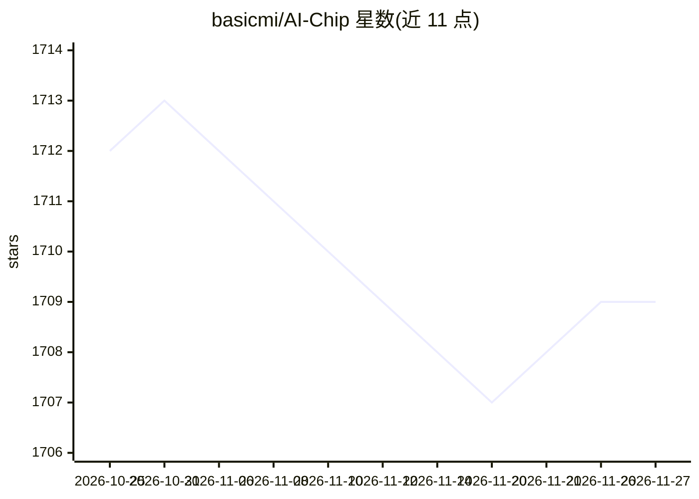

# basicmi/AI-Chip

⭐ 1,709 · Python · 推送 2026-11-26 · [GitHub](https://github.com/basicmi/AI-Chip) · [官网](https://basicmi.github.io/AI-Chip/) · 个人维护 · 中文 README

**面向 AI/ML 从业者的 AI 芯片与 IP 厂商编目清单**

以目录形式汇总用于 AI、机器学习与深度学习的芯片（IC）与 IP 核：按 IC 厂商、科技巨头、IP 供应商、初创公司、被收购/停业厂商、中国 AI 加速器等分组，每条目含厂商简介、产品沿革（如 NVIDIA 各代架构、AMD Instinct 系列）与最新公司/产品状态。声明优先采用官方来源，并注明性能数据多为厂商报告；软件生态与基准测试另设独立页面维护。

## 筛选速览

| 维度 | 判定 | 备注 |
|---|---|---|
| AI 角色 | `ai-knowledge` | 知识聚合/清单类 |
| 许可风险 | `none` | — |
| 部署形态 | `library` | 以包/库形式分发 |
| 模型依赖 | — | README 未给出锁定关系 |
| 硬件要求 | — | 无带数字的原话,不猜 |
| 安装摩擦 | `medium` | 含编译或系统依赖之一 |
| 成熟度 | — | 结构信号不足 |

## 能力要点

- 按厂商类型分组收录 AI 加速器 IC 与 IP 条目
- 每条目含产品代际沿革与当前公司状态（含被收购/停业标注）
- 附带 AI 加速器软件生态、基准测试与兼容性/模型支持专页入口
- 定期更新各公司一句话最新动态

## 适用场景

- 查找某类 AI 加速芯片有哪些厂商与产品型号
- 了解某厂商芯片产品的历代沿革与现状
- 调研中国 AI 加速器厂商格局

## 场景标签

`精选清单` · 领域:学习与行业

## 证据(README 行号)

> L2:  AI Chip (ICs and IPs)
> L8:  A living directory of AI accelerators (ICs &amp; IPs) — each entry has a short field intro, product lineage and cur

## 星数曲线

2026-10-25 1,712 → 2026-11-27 1,709（-3）

---
*卡片 v1 · prompt 1.4 · 生成 2026-11-23 · 置信度 mid · 依据 README sha `3319313d0956` · [字段定义](../../DATASET.md)*
