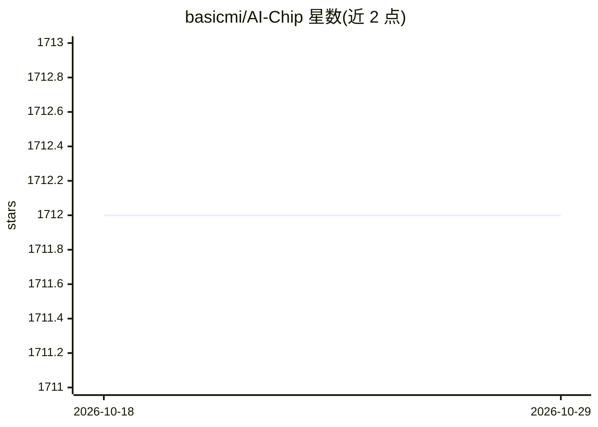

# basicmi/AI-Chip

⭐ 1,712 · PHP · 推送 2026-07-16 · [GitHub](https://github.com/basicmi/AI-Chip) · [官网](https://basicmi.github.io/AI-Chip/) · 个人维护 · 中文 README

**AI/ML/DL 芯片与 IP 的新闻链接策展清单**

由个人维护者（Linkedin S.T.，微信公众号 StarryHeavensAbove）整理的 AI 芯片情报清单：按 IC 厂商（Intel/Qualcomm/Nvidia/Samsung/AMD/IBM/Marvell）、科技巨头与 HPC 厂商（Google/AWS/微软等）、IP 厂商（ARM/Synopsys 等）和创业公司四大板块组织，条目以厂商新闻稿与产品介绍的引用链接为主，覆盖 GPU、NPU、神经形态芯片、TPU 等品类，并跟踪 MLPerf 结果。仅为阅读材料，无可安装组件。

## 筛选速览

| 维度 | 判定 | 备注 |
|---|---|---|
| AI 角色 | `ai-knowledge` | 知识聚合/清单类 |
| 许可风险 | `none` | — |
| 部署形态 | `None` |  |
| 模型依赖 | — | README 未给出锁定关系 |
| 硬件要求 | — | 无带数字的原话,不猜 |
| 安装摩擦 | `low` | 无编译、无系统依赖或容器化 |
| 成熟度 | — | 结构信号不足 |

## 能力要点

- 四大板块组织：IC 厂商、科技巨头/HPC、IP 厂商、创业公司（60+ 家）
- 条目形式为厂商新闻与产品介绍（Hopper、Gaudi2、TPU v4、Trainium 等）的链接引用
- 更新日志跟踪 MLPerf 结果与新创公司收录

## 适用场景

- 调研 AI 芯片厂商与产品格局
- 查找特定厂商（如 Nvidia、Groq、Cerebras）的芯片新闻来源
- 了解 AI 加速器创业公司名录

## 场景标签

`精选清单` · 领域:学习与行业

## 证据(README 行号)

> L1: AI Chip (ICs and IPs)
> L56:  IC Vendors Intel, Qualcomm, Nvidia, Samsung, AMD,IBM, Marvell
> L62:  Startups

## 星数曲线

2026-10-18 1,712 → 2026-10-29 1,712（+0）

---
*卡片 v1 · prompt 1.4 · 生成 2026-10-21 · 置信度 high · 依据 README sha `6a6c435070d8` · [字段定义](../../DATASET.md)*
