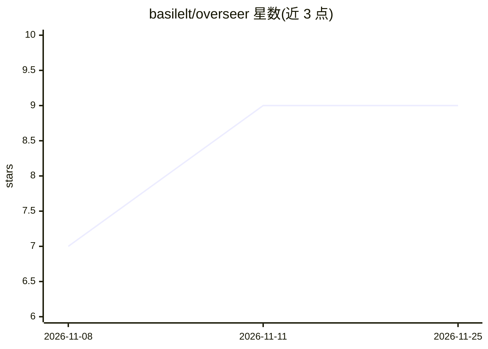

# basilelt/overseer

⭐ 9 · Rust · AGPL-3.0 · 推送 2026-11-23 · [GitHub](https://github.com/basilelt/overseer) · [官网](https://basilelt.github.io/overseer/) · 个人维护

**统一运行与监督多个 AI 编码 agent 的桌面/移动应用**

由桌面应用（Linux/macOS/Windows）、Android/iOS 应用和一个 daemon 组成，用于并排运行和监督多种 AI 编码 CLI（Claude Code、Codex、Gemini CLI 等）。核心机制：每个 agent 会话是一条 line（一个 agent、一个 worktree、一台机器），daemon 持有终端使会话在断网或合盖后继续运行；提供看板任务自动派发、worktree 管理、实时代码审查、Quorum 多 agent 投票合并、SSH 远程主机管理，以及按会话/任务统计 token 成本。

## 筛选速览

| 维度 | 判定 | 备注 |
|---|---|---|
| AI 角色 | `ai-ecosystem` | LLM/agent 周边工具 |
| 许可风险 | `viral` | AGPL-3.0 |
| 部署形态 | `desktop` | 安装包/桌面程序 |
| 模型依赖 | — | README 未给出锁定关系 |
| 硬件要求 | — | 无带数字的原话,不猜 |
| 安装摩擦 | `low` | 无编译、无系统依赖或容器化 |
| 成熟度 | — | 结构信号不足 |

## 能力要点

- 一个窗口管理多种 agent CLI 会话，daemon 保持会话在断连/休眠后不中断
- 看板任务自动创建 worktree 并启动 agent，支持并发限制与 GitHub/GitLab/Jira 导入
- GitHub 式实时审查：行内评论、建议编辑回传 agent，多仓库 Map 视图
- SSH 远程主机运行 agent，单连接承载终端与端口转发，服务端不监听 TCP 端口

## 适用场景

- 同时监督本机和 SSH 服务器上的多个 AI 编码会话
- 用看板批量派发编码任务并自动按顺序启动
- 对 agent 产出的代码改动做行级审查与投票合并
- 在手机/平板上跟进并回复正在运行的 agent

## 场景标签

`多智能体` `编码 Agent` `代码审查` · 领域:Agent 开发

## 证据(README 行号)

> L26: Overseer is a desktop app (Linux, macOS, Windows), a phone and tablet app (Android, iOS) and a small
> L27: daemon. It works with Claude Code, Codex, Gemini CLI, Antigravity, opencode, Amp, Copilot CLI, Cursor
> L63: Write a task, pick the agent, its model and reasoning effort, and start it: Overseer creates a

## 星数曲线

2026-11-08 7 → 2026-11-25 9（+2）

---
*卡片 v1 · prompt 1.4 · 生成 2026-11-20 · 置信度 high · 依据 README sha `ad809ac78c49` · [字段定义](../../DATASET.md)*
