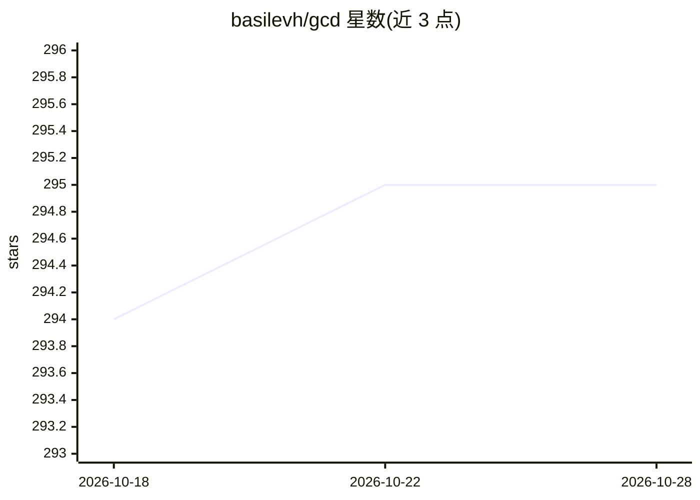

# basilevh/gcd

⭐ 295 · Python · GPL-3.0 · 推送 2025-11-18 · [GitHub](https://github.com/basilevh/gcd) · [官网](https://gcd.cs.columbia.edu/) · 个人维护

**单目动态新视角合成的生成式相机滑轨模型官方实现**

ECCV 2024 Oral 论文 Generative Camera Dolly 的官方 Python 实现：基于 Stable Video Diffusion 微调，从单条 RGB 视频生成沿指定相机轨迹（最大 90/180 度水平旋转等 3-DoF 控制）的动态新视角视频。提供 Kubric-4D 与 ParallelDomain-4D 两个数据集的预处理脚本、预训练权重（每个 20.3 GB）、Gradio 推理界面、训练与评测代码。训练需多 GPU（示例 VRAM 约 50 GB/GPU，实验用 8x A100/A6000），数据预处理需数 TB 磁盘。作者声明代码经重构但未全面验证。

## 筛选速览

| 维度 | 判定 | 备注 |
|---|---|---|
| AI 角色 | `ai-native` | 本体是模型或模型工具 |
| 许可风险 | `viral` | GPL-3.0 |
| 部署形态 | `library` | 以包/库形式分发 |
| 模型依赖 | — | README 未给出锁定关系 |
| 硬件要求 | — | 无带数字的原话,不猜 |
| 安装摩擦 | `medium` | 含编译或系统依赖之一 |
| 成熟度 | — | 结构信号不足 |

## 能力要点

- 基于 SVD 微调，单目 RGB 视频输入生成动态新视角视频
- 3-DoF 相机控制（水平旋转最大 90/180 度），支持 RGB 与语义输出模态
- 提供 Kubric-4D / ParallelDomain-4D 预训练权重（各 20.3 GB）
- 含 Gradio 推理界面、数据集生成、训练与评测完整代码

## 适用场景

- 对自拍摄视频生成环绕或旋转视角的动态画面
- 研究单目动态新视角合成方法并复现 ECCV 2024 论文实验
- 在驾驶场景视频中生成前视方向的视角变换

## 场景标签

`视频生成` · 领域:内容生成

## 证据(README 行号)

> L13: This repository contains the Python code published as part of our paper _"Generative Camera Dolly: Extreme Monocula
> L15: We provide setup instructions, pretrained models, inference code, training code, evaluation code, and dataset gener
> L107: First, download one of the two following available Stable Video Diffusion checkpoints: SVD (14 frames) or SVD-XT (

## 星数曲线

2026-10-18 294 → 2026-10-28 295（+1）

---
*卡片 v1 · prompt 1.4 · 生成 2026-10-21 · 置信度 high · 依据 README sha `a9585bf0a259` · [字段定义](../../DATASET.md)*
