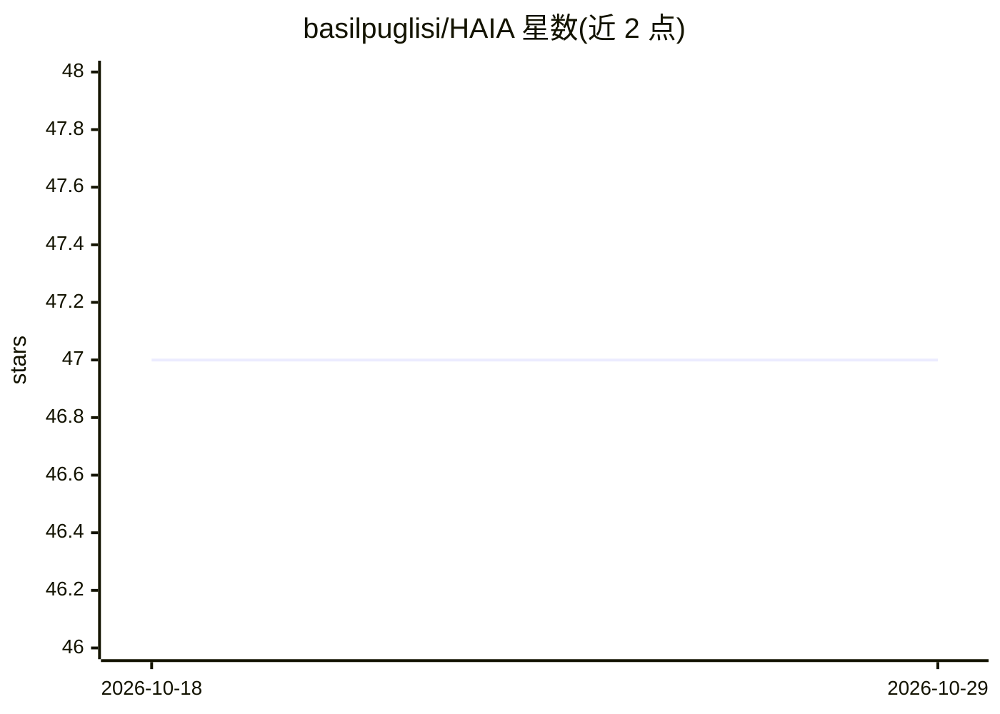

# basilpuglisi/HAIA

⭐ 47 · Python · NOASSERTION · 推送 2026-10-17 · [GitHub](https://github.com/basilpuglisi/HAIA) · [官网](https://basilpuglisi.com) · 个人维护

**多 AI 工作流的治理基础设施：调度、审计与人工检查点**

GOPEL（治理编排策略执行层）的参考实现 v0.6.1：向多个 AI 平台分发相同提示、逐字保留原始响应、将响应路由给 Navigator 做综合、写入防篡改审计日志、在预配置检查点暂停等待人工裁决并输出治理指标。本体限定为七种确定性操作（分发/收集/路由/记录等），不做内容评价、排序或过滤；配套多份治理规范（CBG v5.0、CICE、CPE、CAIPR、后量子密码修订）与三种运行模型。作者声明尚未从概念验证进入生产。

## 筛选速览

| 维度 | 判定 | 备注 |
|---|---|---|
| AI 角色 | `ai-ecosystem` | LLM/agent 周边工具 |
| 许可风险 | `none` | NOASSERTION |
| 部署形态 | `library` | 以包/库形式分发 |
| 模型依赖 | — | README 未给出锁定关系 |
| 硬件要求 | — | 无带数字的原话,不猜 |
| 安装摩擦 | `low` | 无编译、无系统依赖或容器化 |
| 成熟度 | `idea` | |

## 能力要点

- 同一提示分发至多个 AI 平台，原始响应逐字留存审计
- 七种确定性操作，不做任何内容评价或过滤
- 检查点门控的人工裁决（CBG）与防篡改审计日志
- 三种运行模型按风险等级决定检查点密度

## 适用场景

- 高风险 AI 决策流程中插入人工检查点与审计留痕
- 多平台交叉验证场景下治理提示分发与响应收集
- 需要确定性、可审计 AI 治理层的组织合规建设

## 场景标签

`工作流自动化` · 领域:效率与自动化

## 证据(README 行号)

> L22: The HAIA Agent Framework is governance infrastructure for multi-AI workflows. It is the software implementation of 
> L24: The framework dispatches identical prompts to multiple AI platforms, collects responses (originals preserved verbat
> L38: The governing specification for the entire architecture. GOPEL is a non-cognitive multi-AI governance layer, also t

## 星数曲线

2026-10-18 47 → 2026-10-29 47（+0）

---
*卡片 v1 · prompt 1.4 · 生成 2026-10-25 · 置信度 mid · 依据 README sha `2531b8359d97` · [字段定义](../../DATASET.md)*
