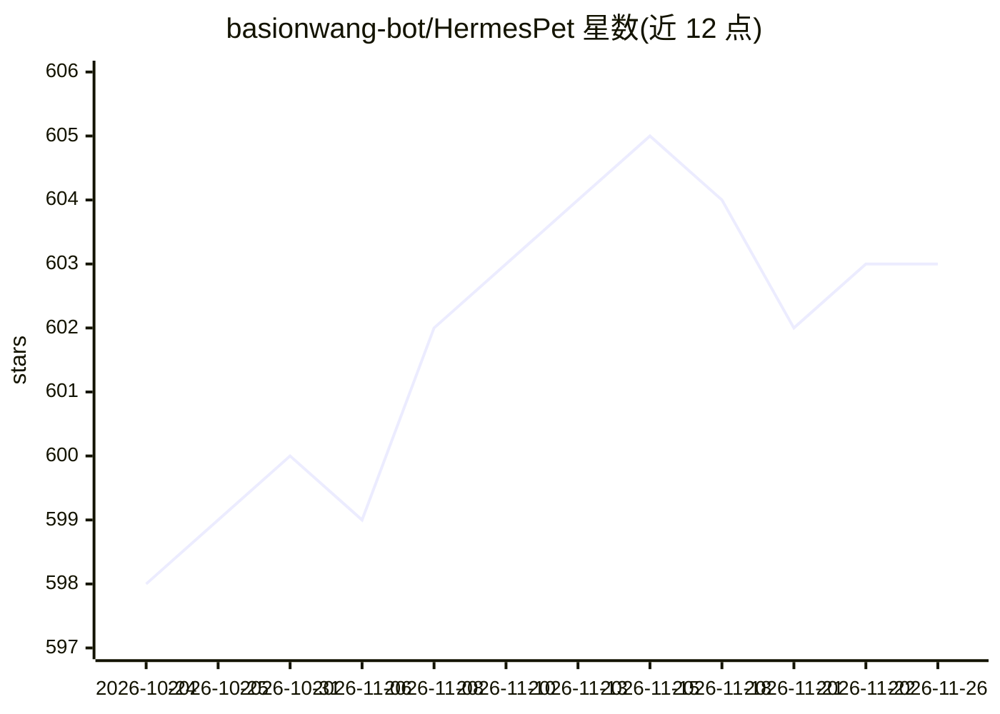

# basionwang-bot/HermesPet

⭐ 603 · TypeScript · 推送 2026-11-10 · [GitHub](https://github.com/basionwang-bot/HermesPet) · [官网](https://hermespet.cc) · 个人维护 · 中文 README

**macOS 桌面 AI 伴侣：住进刘海的多引擎任务控制台**

基于 Swift 6/SwiftUI 的原生 macOS 应用，把对话、截图提问、语音输入、文件拖拽等 AI 交互嵌入刘海与屏幕边缘的侧边操作台。可连接在线模型（自配 API Key），也可复用本机已登录的 Claude Code、Codex、QwenCode、Kimi 等终端；多对话独立并行，展示执行步骤、系统负载与任务进度，并提供知识云图、本地历史记忆与计划任务。官方分发签名的 DMG 安装包（Apple Silicon/Intel），手机与手表配套端仍在开发中。

## 筛选速览

| 维度 | 判定 | 备注 |
|---|---|---|
| AI 角色 | `ai-native` | 本体是模型或模型工具 |
| 许可风险 | `none` | — |
| 部署形态 | `desktop` | 安装包/桌面程序 |
| 模型依赖 | — | README 未给出锁定关系 |
| 硬件要求 | — | 无带数字的原话,不猜 |
| 安装摩擦 | `low` | 无编译、无系统依赖或容器化 |
| 成熟度 | `idea` | |

## 能力要点

- 接入 7 类 AI 节点：在线模型、OpenAI 兼容端点及本机 Claude Code/Codex/QwenCode/Kimi 登录态
- 屏幕边缘控制台展示 CPU、内存、温度、存储、网速与 AI 节点状态
- 多对话并行，呈现文件读取、命令与工具调用的执行过程
- 历史对话本地保存，可生成按关键词/主题检索的知识云图

## 适用场景

- 在不切换窗口的情况下随时向 AI 提问、截图圈选解释
- 同时运行多个 AI 任务并在完成时收到灵动岛提醒
- 把 Claude Code 等终端 Agent 的执行过程集中观察管理
- 离开电脑后用 iPhone 查看进度、批准操作和继续对话

## 场景标签

`AI 助手` · 领域:对话与助手

## 证据(README 行号)

> L27: HermesPet 把 AI 变成 macOS 桌面的一部分：刘海下方是实时任务入口，屏幕边缘是随叫随到的操作台，桌宠会跟随当前 AI 模式切换、提醒任务完成，也能接住你拖来的图片和文件。
> L49: |节点|最适合做什么|接入方式|

## 星数曲线

2026-10-24 598 → 2026-11-26 603（+5）

---
*卡片 v1 · prompt 1.4 · 生成 2026-11-25 · 置信度 high · 依据 README sha `e23e7a5b5230` · [字段定义](../../DATASET.md)*
