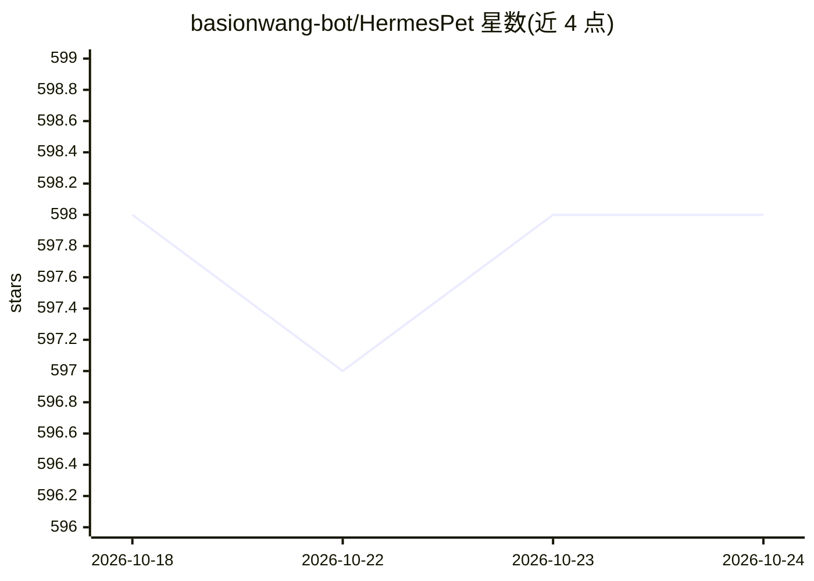

# basionwang-bot/HermesPet

⭐ 599 · TypeScript · 推送 2026-10-15 · [GitHub](https://github.com/basionwang-bot/HermesPet) · [官网](https://hermespet.cc) · 个人维护 · 中文 README

**macOS 刘海桌宠形态的桌面 AI 伴侣与多 Agent 控制台**

原生 macOS（Swift/SwiftUI，macOS 14+）桌面应用：AI 桌宠常驻刘海下方，屏幕边缘展开侧边任务控制台，可同时连接 7 类 AI 终端（在线 AI 服务商、OpenAI 兼容网关、OpenClaw、Claude Code、Codex、QwenCode、Kimi），复用本机已有登录态。支持多对话并行、截图圈选提问、按住说话语音输入、拖文件给桌宠、系统遥测诊断（CPU/内存/温度等）、本地长期记忆与知识云图。iPhone/Apple Watch 配套端仍在开发中，不含在 DMG 内。以签名公证的 DMG 分发，仓库不提供源码构建。

## 筛选速览

| 维度 | 判定 | 备注 |
|---|---|---|
| AI 角色 | `ai-native` | 本体是模型或模型工具 |
| 许可风险 | `none` | — |
| 部署形态 | `desktop` | 安装包/桌面程序 |
| 模型依赖 | — | README 未给出锁定关系 |
| 硬件要求 | — | 无带数字的原话,不猜 |
| 安装摩擦 | `low` | 无编译、无系统依赖或容器化 |
| 成熟度 | `idea` | |

## 能力要点

- 同时连接 7 类 AI 终端，复用本机 Claude Code/Codex/QwenCode/Kimi 登录态
- 灵动岛式桌宠 + 屏幕边缘侧边任务控制台与实时系统诊断
- 截图圈选提问、全局快捷键按住说话、拖文件给桌宠
- 对话与任务记录优先本地保存，API Key 由本机保存

## 适用场景

- 在桌面以桌宠形式同时运行多个 AI 对话与任务
- 不切换窗口即可截图提问、语音输入与查看系统状态
- 远程通过 iPhone 查看 Mac 上 Agent 任务进度并批准高风险操作

## 场景标签

`AI 助手` `多智能体` `Agent 记忆` · 领域:Agent 开发

## 证据(README 行号)

> L7: 原生 macOS AI 桌面伙伴 · 7 类 AI 终端 · 系统遥测 · 多任务并行 · 手机配套端持续开发中
> L29: 它既可以连接在线模型，也能接入本机已经登录的 Claude Code、Codex、QwenCode、Kimi 等终端。不同对话可以独立运行；你看到的不只是最终答案，还包括连接状态、执行步骤、系统负载与任务进度。
> L51: |**Cloud / 在线 AI**|日常问答、写作、总结、视觉理解|App 内选择服务商并配置自己的 API Key|

## 星数曲线

2026-10-18 598 → 2026-10-24 598（+0）

---
*卡片 v1 · prompt 1.4 · 生成 2026-10-21 · 置信度 high · 依据 README sha `8ccb2ce7457e` · [字段定义](../../DATASET.md)*
