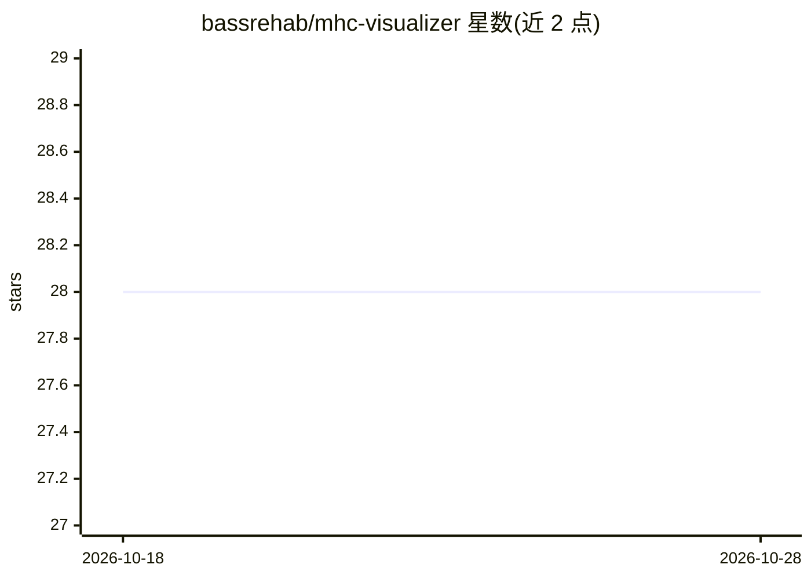

# bassrehab/mhc-visualizer

⭐ 28 · TypeScript · MIT · 推送 2026-07-04 · [GitHub](https://github.com/bassrehab/mhc-visualizer) · [官网](http://subhadipmitra.com/mhc-visualizer/) · 个人维护

**面向学习者的 mHC 稳定性交互可视化与教学工具**

演示并解释 DeepSeek mHC 论文核心思想的交互式项目：通过滑块调节 Sinkhorn 投影迭代次数（0→30），实时观察 Hyper-Connections 从增益爆炸到 mHC 稳定的转变；包含复合增益图、特征值衰减、矩阵热图等图表，以及引导式导览、动画播放与移动端适配。同时提供 Python 模块（sinkhorn_knopp、PyTorch 的 mHCResidual/mHCBlock 残差替换组件，PyTorch 为可选）、32 个测试、Colab 与 Marimo notebook。React 演示需 Node.js 18+。

## 筛选速览

| 维度 | 判定 | 备注 |
|---|---|---|
| AI 角色 | `ai-knowledge` | 知识聚合/清单类 |
| 许可风险 | `permissive` | MIT |
| 部署形态 | `library` | 以包/库形式分发 |
| 模型依赖 | — | README 未给出锁定关系 |
| 硬件要求 | — | 无带数字的原话,不猜 |
| 安装摩擦 | `low` | 无编译、无系统依赖或容器化 |
| 成熟度 | — | 结构信号不足 |

## 能力要点

- 滑块调节 Sinkhorn 迭代次数实时对比 HC/mHC 行为
- 复合增益/特征值/矩阵热图等多类可视化
- 提供 PyTorch 可选的 mHCResidual/mHCBlock 残差替换组件
- 附带 Colab 与 Marimo notebook 及 32 个测试

## 适用场景

- 理解双随机矩阵与 Sinkhorn 投影为何稳定深层网络
- 在浏览器中交互探索 mHC 论文结论
- 在自有 PyTorch 代码中替换残差连接为 mHC 组件

## 场景标签

`教程课程` · 领域:学习与行业

## 证据(README 行号)

> L9: > Interactive visualization demonstrating why Manifold-Constrained Hyper-Connections (mHC) stabilize deep neural net
> L29: **The Manifold Dial:** Our visualization lets you sweep Sinkhorn iterations from 0→30 and watch the transition from

## 星数曲线

2026-10-18 28 → 2026-10-28 28（+0）

---
*卡片 v1 · prompt 1.4 · 生成 2026-10-26 · 置信度 mid · 依据 README sha `400a5cbebf00` · [字段定义](../../DATASET.md)*
