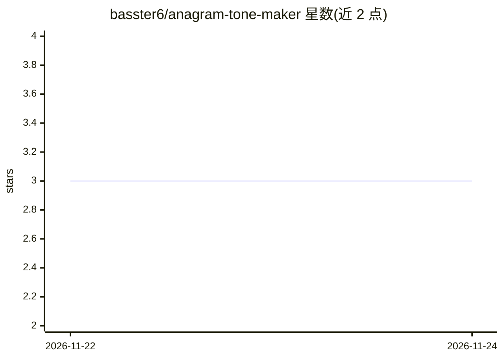

# basster6/anagram-tone-maker

⭐ 3 · JavaScript · MIT · 推送 2026-11-20 · [GitHub](https://github.com/basster6/anagram-tone-maker) · 个人维护 · 中文 README

**让 AI 助手为 Darkglass Anagram 踏板设计音色的技能包**

一个供 AI 助手读取的技能（SKILL.md），配合 Python CLI 工具：内置从设备 USB 实读的完整 block 目录（参数、范围、枚举），用于按自然语言请求生成音色预设；提供预设格式校验、试听、写入槽位（带备份与固件版本检查）等 USB 控制，以及正弦扫频测量与 reamp 对比的本地 studio 页面。写入需固件 1.18/1.19；无踏板也可设计与校验。另提供 MCP server 与实验性浏览器版。

## 筛选速览

| 维度 | 判定 | 备注 |
|---|---|---|
| AI 角色 | `ai-native` | 本体是模型或模型工具 |
| 许可风险 | `permissive` | MIT |
| 部署形态 | `desktop` | 安装包/桌面程序 |
| 模型依赖 | local-ok | 支持本地模型 |
| 硬件要求 | — | 无带数字的原话,不猜 |
| 安装摩擦 | `low` | 无编译、无系统依赖或容器化 |
| 成熟度 | `idea` | |

## 能力要点

- block 目录直接从设备读取，精确对应固件 v1.19.2.24
- CLI 覆盖预设读写、试听、扫频测量、reamp 对比等命令
- 通过 MCP server 支持桌面客户端，通过 .claude/skills 支持 Claude Code 与 Codex
- 浏览器版可接本地 Ollama/LM Studio 等 OpenAI 兼容端点

## 适用场景

- 用自然语言让助手设计贝斯音色并写入踏板槽位
- 测量预设的真实频率响应并对比多个版本
- 校验手写或第三方预设 JSON 是否符合设备格式

## 场景标签

 · 领域:音乐/音频工具

## 证据(README 行号)

> L3: A skill that lets an AI assistant design tones for the **Darkglass Anagram**, check
> L60: SKILL.md                      what the assistant reads
> L97: `tools/mcp_server.py` offers the same commands as MCP tools, so desktop apps can use

## 星数曲线

2026-11-22 3 → 2026-11-24 3（+0）

---
*卡片 v1 · prompt 1.4 · 生成 2026-11-22 · 置信度 high · 依据 README sha `ceb7a9f48da0` · [字段定义](../../DATASET.md)*
