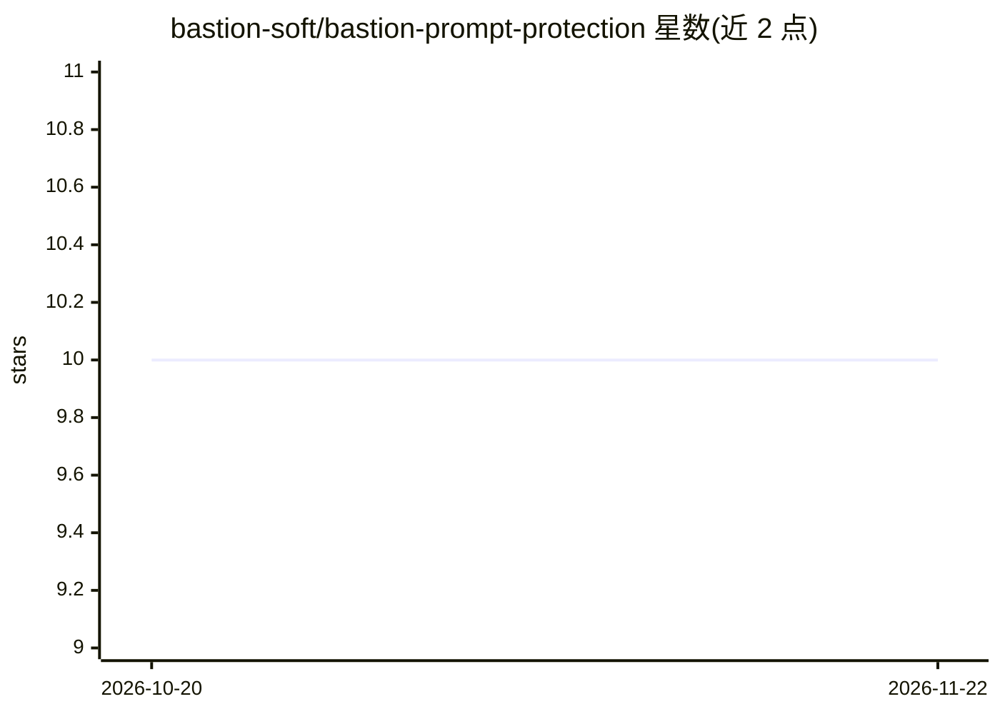

# bastion-soft/bastion-prompt-protection

⭐ 10 · Python · AGPL-3.0 · 推送 2026-09-18 · [GitHub](https://github.com/bastion-soft/bastion-prompt-protection) · [官网](https://bastionsoft.com) · 组织维护

**为 LLM 应用本地检测提示注入与越狱的 Python SDK**

在 LLM 应用内对用户输入与工具结果做本地提示注入/越狱检测：结构化检测器捕捉模板控制 token、混淆与 base64 载荷，DeBERTa-v3-xsmall 微调的 70M ONNX-INT8 模型输出温度校准的风险分数，CPU 推理无 API 调用。提供四种使用方式：裸模型离线加载、SDK（自动下载模型）、自跑评测脚本、Docker HTTP 微服务；另带 LangChain/LlamaIndex/OpenAI Agents SDK/LiteLLM 集成与可选遥测。免费版仅英文，多语言版为商业许可。

## 筛选速览

| 维度 | 判定 | 备注 |
|---|---|---|
| AI 角色 | `ai-native` | 本体是模型或模型工具 |
| 许可风险 | `dual` | AGPL-3.0 |
| 部署形态 | `self-host` | docker 或自建部署 |
| 模型依赖 | — | README 未给出锁定关系 |
| 硬件要求 | — | 无带数字的原话,不猜 |
| 安装摩擦 | `low` | 无编译、无系统依赖或容器化 |
| 成熟度 | — | 结构信号不足 |

## 能力要点

- 本地 CPU 推理，无需 API 调用，ONNX-INT8 量化模型
- 结构化检测器 + 二分类器两级流水线，输出温度校准风险分
- LangChain/LlamaIndex/OpenAI Agents SDK/LiteLLM 四种框架集成
- 评测脚本可复现基准结果，提供 Docker 微服务部署

## 适用场景

- 给 AI agent 与 copilot 加输入与工具结果的安全护栏
- RAG 流水线拦截携带注入的检索文档
- 通过 LiteLLM 网关集中防护所有 LLM 调用
- 自建环境复跑评测验证检测器表现

## 场景标签

`网络安全` `RAG` `模型评测` · 领域:评测与运维

## 证据(README 行号)

> L8: Local prompt-injection and jailbreak detection for LLM applications. Beats every open public baseline we tested. Sel
> L233: 2. **Binary classifier** — the Bastion Prompt Protection model (DeBERTa-v3-xsmall fine-tune, 70M params), ONNX-INT

## 星数曲线

2026-10-20 10 → 2026-11-22 10（+0）

---
*卡片 v1 · prompt 1.4 · 生成 2026-11-19 · 置信度 high · 依据 README sha `edc272f350e3` · [字段定义](../../DATASET.md)*
