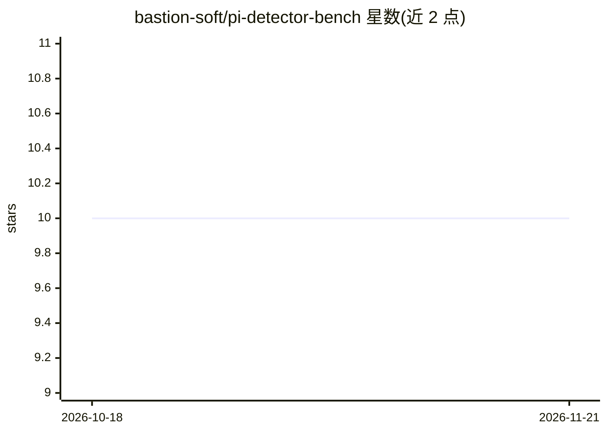

# bastion-soft/pi-detector-bench

⭐ 10 · Python · NOASSERTION · 推送 2026-11-19 · [GitHub](https://github.com/bastion-soft/pi-detector-bench) · 组织维护

**提示注入检测器的双轴开源基准：测捕获率与误报**

面向提示注入检测器的评测基准与可复现方法学：同时测量攻击捕获率与真实流量（WildChat + LMSYS）上的误报率，报告固定捕获率下的 FPR、EER 与操作曲线，避免阈值依赖；另设间接/结构化注入与多轮跨步注入两个独立轴。全部原始分数随仓库提交，可离线无 GPU 复算全部表格。由 Bastion Soft 维护，其自家检测器经同一通用 HuggingFace 路径评分，解释文档标明自身弱点。

## 筛选速览

| 维度 | 判定 | 备注 |
|---|---|---|
| AI 角色 | `ai-ecosystem` | LLM/agent 周边工具 |
| 许可风险 | `permissive` | NOASSERTION |
| 部署形态 | `library` | 以包/库形式分发 |
| 模型依赖 | — | README 未给出锁定关系 |
| 硬件要求 | — | 无带数字的原话,不猜 |
| 安装摩擦 | `low` | 无编译、无系统依赖或容器化 |
| 成熟度 | — | 结构信号不足 |

## 能力要点

- 双轴评测：捕获率 + 真实流量误报，阈值无关（FPR@95% 捕获、EER、操作曲线）
- 原始分数入库，全部结果可离线无 GPU 复现
- 多轮/跨步注入独立评测轴，按注入深度分层
- 单文件 PR 接入新检测器（models.yaml）

## 适用场景

- 为业务场景选型提示注入检测器时比较误报成本
- 把自己的检测器提交到排行榜对比
- 离线复算验证基准结果

## 场景标签

`模型评测` `网络安全` · 领域:评测与运维

## 证据(README 行号)

> L7: **An open, model-agnostic benchmark for prompt-injection *detectors* — measured on both axes (attack catch-rate **an
> L61: It's not another attack dataset — it's a **methodology** (see `METHODOLOGY.md`):

## 星数曲线

2026-10-18 10 → 2026-11-21 10（+0）

---
*卡片 v1 · prompt 1.4 · 生成 2026-11-19 · 置信度 high · 依据 README sha `850000486a60` · [字段定义](../../DATASET.md)*
