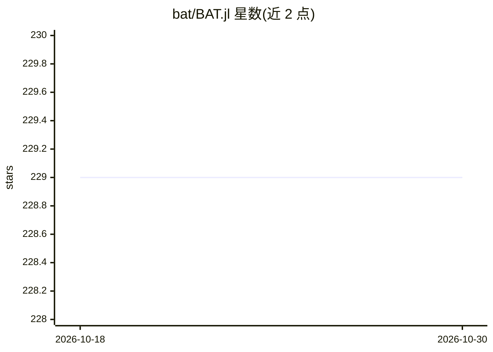

# bat/BAT.jl

⭐ 229 · Julia · NOASSERTION · 推送 2026-10-29 · [GitHub](https://github.com/bat/BAT.jl) · 组织维护

**Julia 贝叶斯分析工具包：后验采样、众数估计与积分**

BAT.jl 是用 Julia 编写的贝叶斯分析工具包，提供多种后验采样、众数估计和积分算法，并附绘图配方与 I/O 功能。它源自 C++ 版 BAT 的重写与再设计，功能集与算法种类与其前身不同。安装需 Julia >= v1.10，通过 Pkg 添加；面向统计推断的科研用户，README 提示研究或教学使用时引用其 CITATION.bib。

## 筛选速览

| 维度 | 判定 | 备注 |
|---|---|---|
| AI 角色 | `ai-native` | 本体是模型或模型工具 |
| 许可风险 | `none` | NOASSERTION |
| 部署形态 | `None` |  |
| 模型依赖 | — | README 未给出锁定关系 |
| 硬件要求 | — | 无带数字的原话,不猜 |
| 安装摩擦 | `low` | 无编译、无系统依赖或容器化 |
| 成熟度 | — | 结构信号不足 |

## 能力要点

- 多种后验采样、众数估计与积分算法
- 附绘图配方与 I/O 功能
- Julia >= v1.10，通过 Pkg 安装

## 适用场景

- 对统计模型做贝叶斯后验采样
- 进行众数估计与积分计算
- 科研或教学中的贝叶斯统计分析

## 场景标签

`科研工具` · 领域:学习与行业

## 证据(README 行号)

> L10: Welcome to BAT, a Bayesian analysis toolkit in Julia.
> L12: BAT.jl offers a variety of posterior sampling, mode estimation and integration algorithms, supplemented by plotting

## 星数曲线

2026-10-18 229 → 2026-10-30 229（+0）

---
*卡片 v1 · prompt 1.4 · 生成 2026-10-22 · 置信度 high · 依据 README sha `fd39945cfc37` · [字段定义](../../DATASET.md)*
