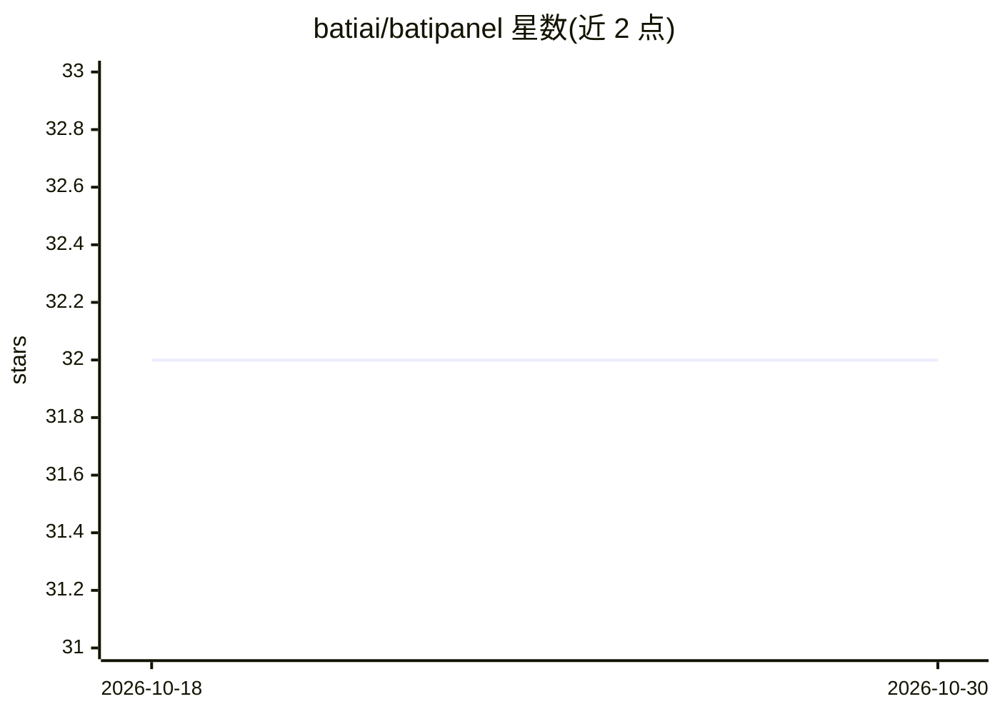

# batiai/batipanel

⭐ 32 · Shell · MIT · 推送 2026-03-18 · [GitHub](https://github.com/batiai/batipanel) · [官网](https://batipanel.com) · 组织维护

**面向 AI 编程的 tmux 终端工作区管理器，一条命令搭建环境**

基于 tmux 的终端工作区管理工具：一条安装命令自动装好 tmux、Claude Code、lazygit、btop、yazi、eza 并配置终端主题与 Nerd Font；用 `b 项目名` 启动或恢复持久化多面板会话，提供 8 种布局（含双 Claude 面板）、8 套配色、vim 风格快捷键。工具缺失时逐级回退。另含实验性的 Telegram AI Bot（Docker 隔离部署）。支持 macOS/Linux/WSL2，通过 curl 脚本、npm、Homebrew 或源码安装。

## 筛选速览

| 维度 | 判定 | 备注 |
|---|---|---|
| AI 角色 | `ai-enhanced` | 去掉 AI 部分产品仍成立 |
| 许可风险 | `permissive` | MIT |
| 部署形态 | `library` | 以包/库形式分发 |
| 模型依赖 | — | README 未给出锁定关系 |
| 硬件要求 | — | 无带数字的原话,不猜 |
| 安装摩擦 | `low` | 无编译、无系统依赖或容器化 |
| 成熟度 | `idea` | |

## 能力要点

- 一条命令自动安装 Claude Code 与 5 个开发工具并配置终端
- 8 种面板布局（含 dual-claude 多 AI 布局）与 8 套配色主题，会话持久化
- 工具缺失时自动回退（btop→htop→top）
- 实验性 Telegram AI Bot，5 层 Docker 隔离

## 适用场景

- 一条命令搭好带 AI 编程工具的终端开发环境
- 在 SSH 断线后恢复完整的多面板工作区
- 双面板同时运行多个 Claude Code 会话
- 通过 Telegram 部署个人 AI Bot

## 场景标签

`聊天机器人` · 领域:对话与助手

## 证据(README 行号)

> L13: **One command. Full dev environment.** Auto-installs Claude Code, lazygit, btop, yazi + configures your terminal. M
> L23: 1. **Auto-installs everything** — tmux, Claude Code, lazygit, btop, yazi, eza (+ Nerd Font on macOS)
> L337: |**Claude Code**|Recommended|`curl -fsSL https://claude.ai/install.sh \|bash`|

## 星数曲线

2026-10-18 32 → 2026-10-30 32（+0）

---
*卡片 v1 · prompt 1.4 · 生成 2026-10-26 · 置信度 high · 依据 README sha `1b04e7f0e5d1` · [字段定义](../../DATASET.md)*
