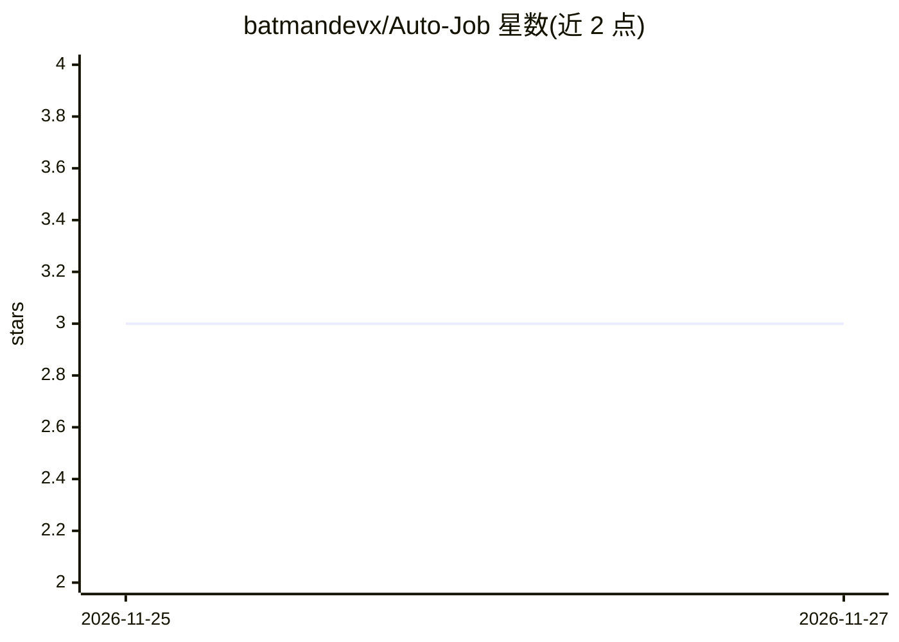

# batmandevx/Auto-Job

⭐ 3 · JavaScript · MIT · 推送 2026-11-12 · [GitHub](https://github.com/batmandevx/Auto-Job) · 个人维护

**求职者用的浏览器扩展：自动生成简历/求职信并填表投递**

Chrome/Arc 浏览器扩展加一个运行在本机的 Node 服务器：读取职位描述后生成一页 ATS 友好简历与四段式求职信并上传，自动填写申请表（支持 Workday 下拉、iframe、shadow DOM 等字段类型），从 Gmail 读取 OTP 验证码与验证链接，用 Gemini 视觉检查已填页面，并在最终 Submit 前停下等用户确认。还提供申请追踪、垃圾箱扫描、黑客松列表与 Excel 导出。数据存于本地 data/ 目录，服务器仅监听 127.0.0.1，需 Node 20+。

## 筛选速览

| 维度 | 判定 | 备注 |
|---|---|---|
| AI 角色 | `ai-native` | 本体是模型或模型工具 |
| 许可风险 | `permissive` | MIT |
| 部署形态 | `library` | 以包/库形式分发 |
| 模型依赖 | local-ok | 支持本地模型 |
| 硬件要求 | — | 无带数字的原话,不猜 |
| 安装摩擦 | `low` | 无编译、无系统依赖或容器化 |
| 成熟度 | — | 结构信号不足 |

## 能力要点

- 按职位关键词定制一页 ATS 简历并附关键词覆盖率报告
- 自动填各类表单字段并逐页翻页、读错误提示并修正
- 从 Gmail 自动读取 OTP 验证码与验证链接
- 最终 Submit 由用户按下，扩展不会代为提交

## 适用场景

- 批量投递求职申请时减少重复填表
- 针对不同职位快速定制简历和求职信
- 追踪已投申请的回复与拒信

## 场景标签

`浏览器自动化` `工作流自动化` `AI 写作` · 领域:效率与自动化

## 证据(README 行号)

> L7: A Chrome / Arc extension and a small local server that read a job posting, tailor a one-page ATS-friendly resume and
> L33: |Rewrite your resume for every posting|Tailors a one-page PDF to the job's keywords, using only your real experienc
> L53: - **✉️ Writes the cover letter.** Four paragraphs (hook, proof, fit, close) with your real numbers. A quality check

## 星数曲线

2026-11-25 3 → 2026-11-27 3（+0）

---
*卡片 v1 · prompt 1.4 · 生成 2026-11-24 · 置信度 mid · 依据 README sha `fbe019d3b583` · [字段定义](../../DATASET.md)*
