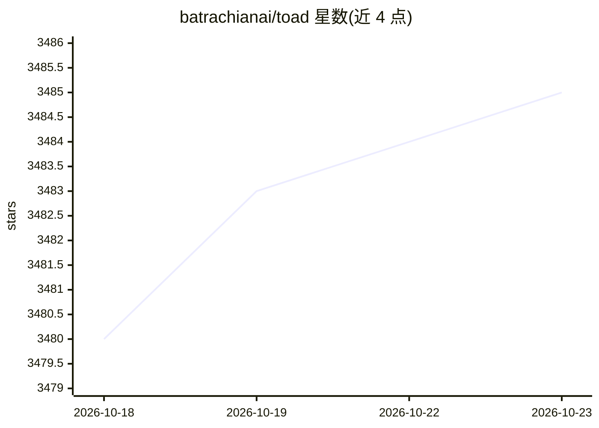

# batrachianai/toad

⭐ 3,485 · Python · AGPL-3.0 · 推送 2026-05-26 · [GitHub](https://github.com/batrachianai/toad) · [官网](https://www.batrachian.ai/) · 个人维护

**终端里的编码 agent 统一界面：安装运行多种 AI agent**

基于 Textual 的终端 UI 应用，用于查找、安装并运行 Claude、Gemini、Codex、OpenHand 等编码 agent，支持通过 Agent Client Protocol 添加自定义 agent。内置完整 shell（可持久化目录与环境变量、交互命令、Tab 补全）、Markdown 提示编辑器、@ 文件模糊选择器、语法高亮 diff、多 agent 并发会话与恢复、图形化设置；也可用 toad serve 以 Web 应用形式运行。支持 Linux/macOS，Windows 需经 WSL。提供 curl 安装脚本、uv 与 pixi 安装途径；Linux 剪贴板功能需安装 xclip。

## 筛选速览

| 维度 | 判定 | 备注 |
|---|---|---|
| AI 角色 | `ai-ecosystem` | LLM/agent 周边工具 |
| 许可风险 | `dual` | AGPL-3.0 |
| 部署形态 | `None` |  |
| 模型依赖 | — | README 未给出锁定关系 |
| 硬件要求 | — | 无带数字的原话,不猜 |
| 安装摩擦 | `low` | 无编译、无系统依赖或容器化 |
| 成熟度 | — | 结构信号不足 |

## 能力要点

- 统一界面查找、安装、运行多种编码 agent（Agent Client Protocol 可扩展）
- 内置完整 shell：环境持久化、全彩输出、交互命令与 Tab 补全
- 多 agent 并发会话（ctrl+s 总览）与会话恢复（ctrl+r）
- 可通过 toad serve 作为 Web 应用运行

## 适用场景

- 在一个终端界面中管理和切换多个编码 agent
- 将 agent 提示与本地 shell 工作流交替执行
- 为开发者自己的 agent 接入统一界面

## 场景标签

`编码 Agent` · 领域:编码与开发

## 证据(README 行号)

> L29: Toad is an interface to coding agents, such as Claude, Gemini, Codex, OpenHand, and many more.
> L35:  Find, install, and run dozens of agents directly from the Toad UI.
> L40:  Developers can add support for their own agents, via the Agent Client Protocol.

## 星数曲线

2026-10-18 3,480 → 2026-10-23 3,485（+5）

---
*卡片 v1 · prompt 1.4 · 生成 2026-10-20 · 置信度 high · 依据 README sha `ebe0f7a7ea4b` · [字段定义](../../DATASET.md)*
