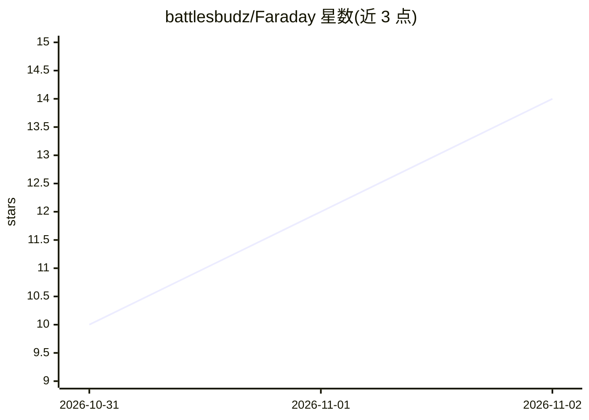

# battlesbudz/Faraday

⭐ 14 · Kotlin · NOASSERTION · 推送 2026-11-01 · [GitHub](https://github.com/battlesbudz/Faraday) · 个人维护

**安卓端完全离线的私人语音助手应用**

面向 Android 11+ 手机用户的本地语音助手：唤醒词触发对话，语音识别（Whisper）、AI 推理（Gemma via LiteRT-LM）与语音合成（Piper）全部在设备端运行，飞行模式下可用。支持全双工音频、语音打断、电话/媒体控制、自动记忆、照片描述与响应耗时导出。以 APK 安装包形式从 GitHub releases 分发，需下载约 2.6-3.7 GB 模型，推荐 12 GB 内存。采用 PolyForm Noncommercial 许可，商业使用需授权。

## 筛选速览

| 维度 | 判定 | 备注 |
|---|---|---|
| AI 角色 | `ai-native` | 本体是模型或模型工具 |
| 许可风险 | `none` | NOASSERTION |
| 部署形态 | `desktop` | 安装包/桌面程序 |
| 模型依赖 | — | README 未给出锁定关系 |
| 硬件要求 | — | 无带数字的原话,不猜 |
| 安装摩擦 | `low` | 无编译、无系统依赖或容器化 |
| 成熟度 | — | 结构信号不足 |

## 能力要点

- 语音识别、推理、合成全链路在设备端运行，飞行模式可用
- 全双工音频与 barge-in：可在播报中语音打断
- 自动跨对话记忆，可查看、修正、删除
- 响应耗时测量并可导出 JSON/CSV

## 适用场景

- 在无网络环境下用语音与我对话并操作手机
- 离线状态下让助手描述照片内容
- 查看语音管线各阶段耗时做性能评估

## 场景标签

`语音 Agent` `AI 助手` · 领域:对话与助手

## 证据(README 行号)

> L3:  A private offline Android voice agent.
> L5:  The conversation runs on your phone, including speech recognition, AI inference, and the spoken reply.
> L125: The app uses Kotlin and Jetpack Compose, with Gemma through LiteRT-LM, Whisper for speech recognition, and Piper f

## 星数曲线

2026-10-31 10 → 2026-11-02 14（+4）

---
*卡片 v1 · prompt 1.4 · 生成 2026-11-01 · 置信度 high · 依据 README sha `be1b88ec560f` · [字段定义](../../DATASET.md)*
