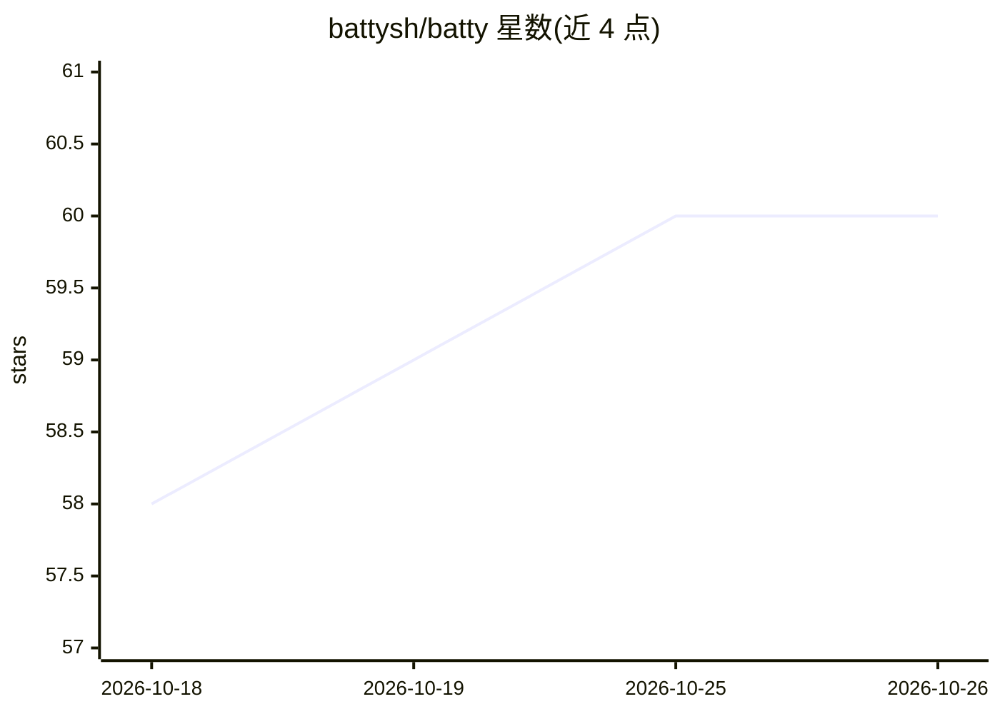

# battysh/batty

⭐ 60 · Rust · MIT · 推送 2026-08-18 · [GitHub](https://github.com/battysh/batty) · [官网](https://batty.sh) · 个人维护

**软件团队的分层编码 Agent 监督执行控制平面**

用 Rust 编写的 CLI/守护进程，用于编排多角色（architect/manager/engineer）编码 agent 团队：以 YAML 定义拓扑，在 tmux 中启动各 agent，通过类型化 SDK 协议（Claude stream-json、Codex JSONL、Kiro ACP）或 PTY shim 接入 agent CLI，按看板调度任务，engineer 在独立 git worktree 中工作，完成后守护进程自动测试、失败重试、绿灯合并。提供 Discord/Telegram 控制面、SQLite 遥测与 Grafana 仪表盘。经 cargo install 安装。

## 筛选速览

| 维度 | 判定 | 备注 |
|---|---|---|
| AI 角色 | `ai-ecosystem` | LLM/agent 周边工具 |
| 许可风险 | `permissive` | MIT |
| 部署形态 | `library` | 以包/库形式分发 |
| 模型依赖 | locked-api |  |
| 硬件要求 | — | 无带数字的原话,不猜 |
| 安装摩擦 | `low` | 无编译、无系统依赖或容器化 |
| 成熟度 | — | 结构信号不足 |

## 能力要点

- 分层角色监督：architect 规划、manager 分发、engineer 在独立 worktree 执行
- 闭环验证：完成自动测试、失败重试、绿灯自动合并
- 多 provider 接入：Claude/Codex/Kiro 等 agent CLI 的 SDK 协议与 PTY shim 回退
- Discord/Telegram 三通道控制面与 Grafana 监控告警

## 适用场景

- 用多个编码 agent 角色分工并行开发软件功能
- 从手机经 Discord/Telegram 监控和指挥 agent 团队
- 长期运行 agent 团队时追踪看板健康与吞吐指标

## 场景标签

`编码 Agent` `多智能体` · 领域:Agent 开发

## 证据(README 行号)

> L19: Batty is a control plane for agent software teams. Instead of one overloaded coding
> L80: interface. Each agent uses a typed SDK protocol (Claude: stream-json NDJSON,
> L92: - **Multi-provider support**: mix Claude, Codex, Kiro, and other supported agent

## 星数曲线

2026-10-18 58 → 2026-10-26 60（+2）

---
*卡片 v1 · prompt 1.4 · 生成 2026-10-24 · 置信度 high · 依据 README sha `eeb8a2b819ae` · [字段定义](../../DATASET.md)*
