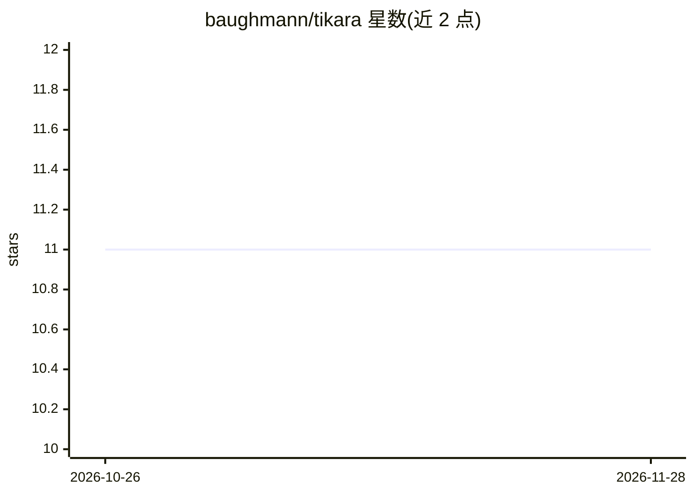

# baughmann/tikara

⭐ 11 · Python · Apache-2.0 · 推送 2026-11-23 · [GitHub](https://github.com/baughmann/tikara) · [官网](https://baughmann.github.io/tikara/) · 个人维护

**基于 Apache Tika 的 Python 文档内容与元数据提取库**

对 Apache Tika 的类型标注 Python 封装，支持 1600+ 种文件格式的内容提取、元数据分析与语言检测；通过 JPype 直接以 JNI 集成 JVM，无需 HTTP 服务器，内置 Tika JAR 可在隔离网络运行。需要 Python 3.12+ 与 JDK 11+，可选安装 Tesseract、FFmpeg、GDAL 等系统组件以增强 OCR、多媒体、地理空间等格式支持。提供流式读取、递归解包、自定义解析器扩展，以 PyPI 包发布。

## 筛选速览

| 维度 | 判定 | 备注 |
|---|---|---|
| AI 角色 | `ai-enhanced` | 去掉 AI 部分产品仍成立 |
| 许可风险 | `permissive` | Apache-2.0 |
| 部署形态 | `self-host` | docker 或自建部署 |
| 模型依赖 | — | README 未给出锁定关系 |
| 硬件要求 | — | 无带数字的原话,不猜 |
| 安装摩擦 | `low` | 无编译、无系统依赖或容器化 |
| 成熟度 | — | 结构信号不足 |

## 能力要点

- 支持 1682 种媒体类型的内容与元数据提取
- JPype JNI 直连 JVM，无需 HTTP 服务，内置 Tika JAR 支持隔离网络
- 语言检测、MIME 类型检测与递归文档解包
- 流式读取大文件与自定义解析器/检测器扩展

## 适用场景

- 为 Python 应用批量解析 docx/pdf 等文档的正文与元数据
- 在 Ray/Dask/Prefect 数据流水线中做文档处理
- 对未知文件做 MIME 类型与语言检测
- 在无法访问外网的容器环境中提取文档内容

## 场景标签

`文档解析` `OCR` · 领域:知识与检索

## 证据(README 行号)

> L9: Tikara is a modern, type-hinted Python wrapper for Apache Tika, supporting over 1600 file formats for content extrac
> L24: - Language detection

## 星数曲线

2026-10-26 11 → 2026-11-28 11（+0）

---
*卡片 v1 · prompt 1.4 · 生成 2026-11-18 · 置信度 low · 依据 README sha `36fbebc84fa2` · [字段定义](../../DATASET.md)*
