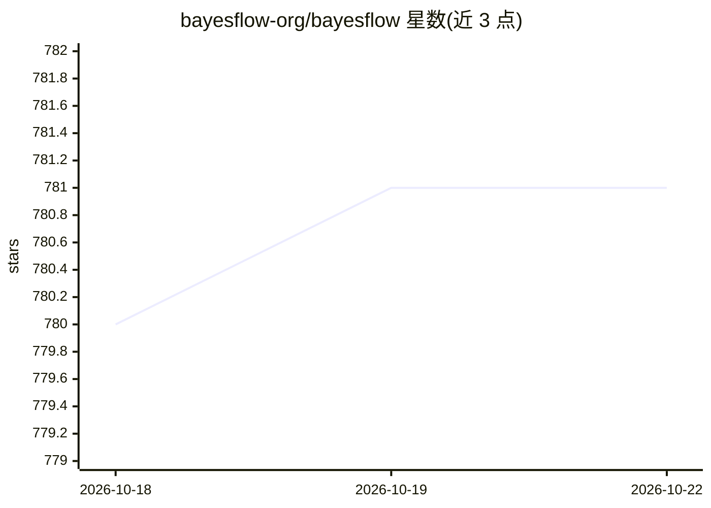

# bayesflow-org/bayesflow

⭐ 782 · Python · MIT · 推送 2026-10-22 · [GitHub](https://github.com/bayesflow-org/bayesflow) · [官网](https://bayesflow.org/) · 组织维护

**基于深度学习的摊销贝叶斯推断 Python 库，面向科研用户**

BayesFlow 是用于仿真推断（simulation-based inference）的 Python 库：通过神经网络训练摊销化的后验、似然、比率或点估计器，支持集成与组合估计，处理滤波、平滑与层级模型；内置从扩散模型到一致性模型的生成式模型集合与诊断工具，兼容复杂仿真器与参数化模型，并提供 PyMC 集成。经 Keras3 支持 PyTorch/TensorFlow/JAX 三后端（需自装其一，缺后端无法运行）。2.0 为完全重写版本。

## 筛选速览

| 维度 | 判定 | 备注 |
|---|---|---|
| AI 角色 | `ai-native` | 本体是模型或模型工具 |
| 许可风险 | `permissive` | MIT |
| 部署形态 | `library` | 以包/库形式分发 |
| 模型依赖 | — | README 未给出锁定关系 |
| 硬件要求 | — | 无带数字的原话,不猜 |
| 安装摩擦 | `low` | 无编译、无系统依赖或容器化 |
| 成熟度 | — | 结构信号不足 |

## 能力要点

- 训练摊销化的神经后验/似然/比率/点估计器，支持集成与组合
- 经 Keras3 支持 JAX/PyTorch/TensorFlow 多后端
- 生成式模型集合（含扩散与一致性模型）及诊断工具套件
- PyMC 集成与 15 个教程 notebook、教程论文

## 适用场景

- 用复杂仿真器做摊销贝叶斯推断与参数估计
- 流行病（SIR）等科学模型的端到端贝叶斯工作流
- 贝叶斯模型比较与自适应实验设计

## 场景标签

`科研工具` · 领域:学习与行业

## 证据(README 行号)

> L9: BayesFlow is a Python library for efficient Bayesian inference with deep learning.
> L20: BayesFlow is a flexible framework for Bayesian inference with deep learning—from idea to results in just a few line

## 星数曲线

2026-10-18 780 → 2026-10-22 781（+1）

---
*卡片 v1 · prompt 1.4 · 生成 2026-10-21 · 置信度 high · 依据 README sha `262b5aebd546` · [字段定义](../../DATASET.md)*
