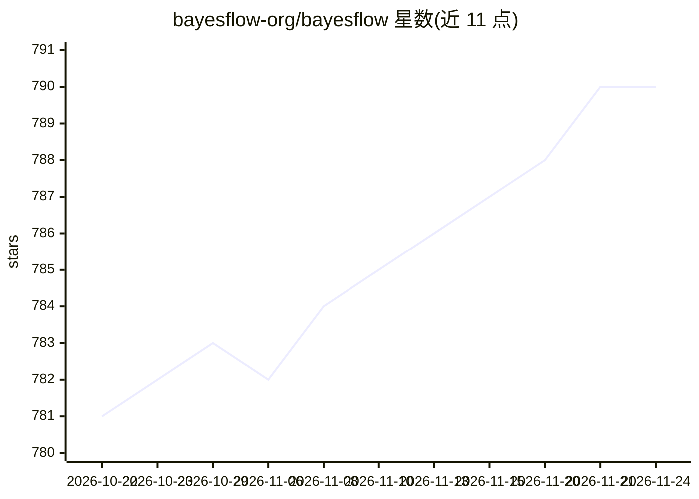

# bayesflow-org/bayesflow

⭐ 790 · Python · MIT · 推送 2026-11-20 · [GitHub](https://github.com/bayesflow-org/bayesflow) · [官网](https://bayesflow.org/) · 组织维护

**面向科研人员的基于仿真的深度学习贝叶斯推断库**

BayesFlow 是用于仿真推断（SBI）的 Python 库：用户从任意仿真器生成数据，用深度神经网络训练后验、似然、比率或点估计器，实现摊销化的贝叶斯工作流，并配套诊断工具与 PyMC 集成。库本身不绑定具体框架，依赖 Keras 3 多后端（PyTorch/TensorFlow/JAX），需自行安装其中之一方可运行；支持 Python 3.12/3.13，从 PyPI、uv 或源码安装，并提供教程笔记本、视频与论文资源。

## 筛选速览

| 维度 | 判定 | 备注 |
|---|---|---|
| AI 角色 | `ai-native` | 本体是模型或模型工具 |
| 许可风险 | `permissive` | MIT |
| 部署形态 | `library` | 以包/库形式分发 |
| 模型依赖 | — | README 未给出锁定关系 |
| 硬件要求 | — | 无带数字的原话,不猜 |
| 安装摩擦 | `low` | 无编译、无系统依赖或容器化 |
| 成熟度 | — | 结构信号不足 |

## 能力要点

- 摊销化贝叶斯工作流的高层 API（BasicWorkflow 等）
- 多后端支持：通过 Keras 3 使用 PyTorch、TensorFlow 或 JAX
- 内置扩散模型到一致性模型的生成模型集合
- 训练后验/似然/比率/点估计器并组合、集成

## 适用场景

- 从仿真器数据中训练神经后验估计器做参数推断
- 传染病 SIR 等模型的端到端贝叶斯工作流
- 层级贝叶斯模型与贝叶斯实验设计
- 学习合成似然并接入 PyMC/MCMC 流程

## 场景标签

`科研工具` `教程课程` · 领域:学习与行业

## 证据(README 行号)

> L9: BayesFlow is a Python library for simulation-based inference (SBI) with deep learning.
> L20: BayesFlow is a flexible framework for Bayesian inference with deep learning—from idea to results in just a few line

## 星数曲线

2026-10-22 781 → 2026-11-24 790（+9）

---
*卡片 v1 · prompt 1.4 · 生成 2026-11-24 · 置信度 high · 依据 README sha `4168ac3e2f90` · [字段定义](../../DATASET.md)*
