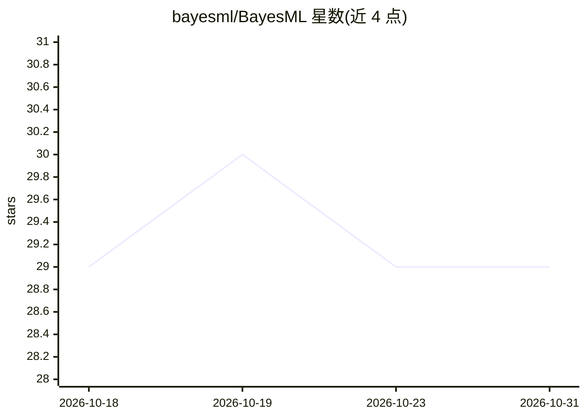

# bayesml/BayesML

⭐ 29 · Python · BSD-3-Clause · 推送 2026-10-27 · [GitHub](https://github.com/bayesml/BayesML) · [官网](https://bayesml.github.io/BayesML/) · 组织维护

**面向教学科研的贝叶斯机器学习 Python 库**

提供 15 种预定义贝叶斯统计模型（伯努利、正态、线性回归、隐马尔可夫等），每个模型含 GenModel（先验/后验参数与数据生成）与 LearnModel（后验更新、参数估计、预测）两类，API 对应贝叶斯决策理论结构，也实现 fit-predict 式函数。多数算法利用共轭先验做精确计算或变分推断，部分采用模型专用 MCMC；全部模型支持在 2~3 维空间可视化数据生成模型与后验分布。面向教学、科研与应用开发者，pip 安装。

## 筛选速览

| 维度 | 判定 | 备注 |
|---|---|---|
| AI 角色 | `ai-native` | 本体是模型或模型工具 |
| 许可风险 | `permissive` | BSD-3-Clause |
| 部署形态 | `library` | 以包/库形式分发 |
| 模型依赖 | — | README 未给出锁定关系 |
| 硬件要求 | — | 无带数字的原话,不猜 |
| 安装摩擦 | `low` | 无编译、无系统依赖或容器化 |
| 成熟度 | — | 结构信号不足 |

## 能力要点

- 15 种预定义贝叶斯模型，无需自行定义模型
- GenModel/LearnModel 双类 API 对应贝叶斯决策理论
- 利用共轭先验的精确计算与变分贝叶斯算法，支持在线学习
- 全模型提供生成模型与后验分布的可视化方法

## 适用场景

- 学习贝叶斯统计与决策理论的教学场景
- 用共轭先验快速做参数估计与新数据预测
- 生成合成数据并可视化理解概率模型与算法特性

## 场景标签

`教程课程` · 领域:学习与行业

## 证据(README 行号)

> L10:  * You can use pre-defined Bayesian statistical models by simply importing it. You don't need to define models your
> L12:  * BayesML's API corresponds to the structure of decision-making based on Bayesian decision theory. Bayesian decisi

## 星数曲线

2026-10-18 29 → 2026-10-31 29（+0）

---
*卡片 v1 · prompt 1.4 · 生成 2026-10-26 · 置信度 high · 依据 README sha `19f325af9ef2` · [字段定义](../../DATASET.md)*
