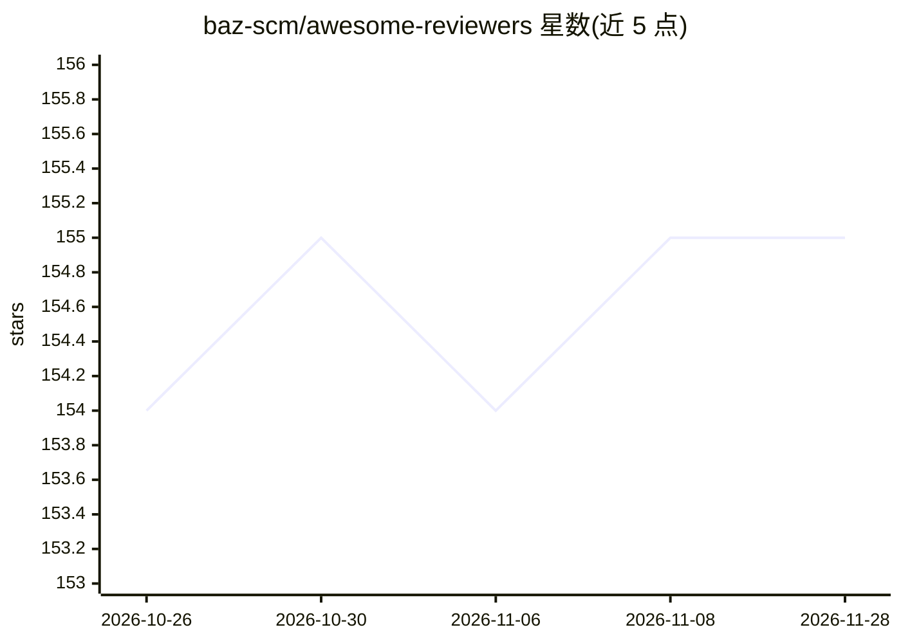

# baz-scm/awesome-reviewers

⭐ 155 · HTML · Apache-2.0 · 推送 2026-11-04 · [GitHub](https://github.com/baz-scm/awesome-reviewers) · [官网](https://awesomereviewers.com/) · 组织维护

**面向开发者的代码审查 Agent 提示词合集**

汇集可用于 Agentic Code Review 的即用型系统提示词，内容分为两部分：Reviewers（提炼自生产仓库真实代码评审讨论的指令）与 Verification（按策略分组的检查构建与识别技巧）。提供网站 awesomereviewers.com 浏览，支持按类型、类别或语言过滤并复制指令。以 Apache-2.0 许可开源，接受社区贡献。

## 筛选速览

| 维度 | 判定 | 备注 |
|---|---|---|
| AI 角色 | `ai-knowledge` | 知识聚合/清单类 |
| 许可风险 | `permissive` | Apache-2.0 |
| 部署形态 | `None` |  |
| 模型依赖 | — | README 未给出锁定关系 |
| 硬件要求 | — | 无带数字的原话,不猜 |
| 安装摩擦 | `low` | 无编译、无系统依赖或容器化 |
| 成熟度 | — | 结构信号不足 |

## 能力要点

- 提炼自生产仓库真实代码评审讨论的 Reviewer 指令
- 按策略分组的 Verification 检查技巧
- 配套网站支持搜索、过滤与复制指令

## 适用场景

- 为代码审查 Agent 配置现成的系统提示词
- 按语言或类别查找适合的评审指令
- 参考仓库中检查技巧构建代码检查

## 场景标签

`提示工程` `代码审查` · 领域:Agent 开发

## 证据(README 行号)

> L5: - **Reviewers** — instructions distilled from real code review discussions in production repositories.
> L8: Browse at awesomereviewers.com. Search with `/`, filter by type,

## 星数曲线

2026-10-26 154 → 2026-11-28 155（+1）

---
*卡片 v1 · prompt 1.4 · 生成 2026-11-27 · 置信度 mid · 依据 README sha `204ab836ffa5` · [字段定义](../../DATASET.md)*
