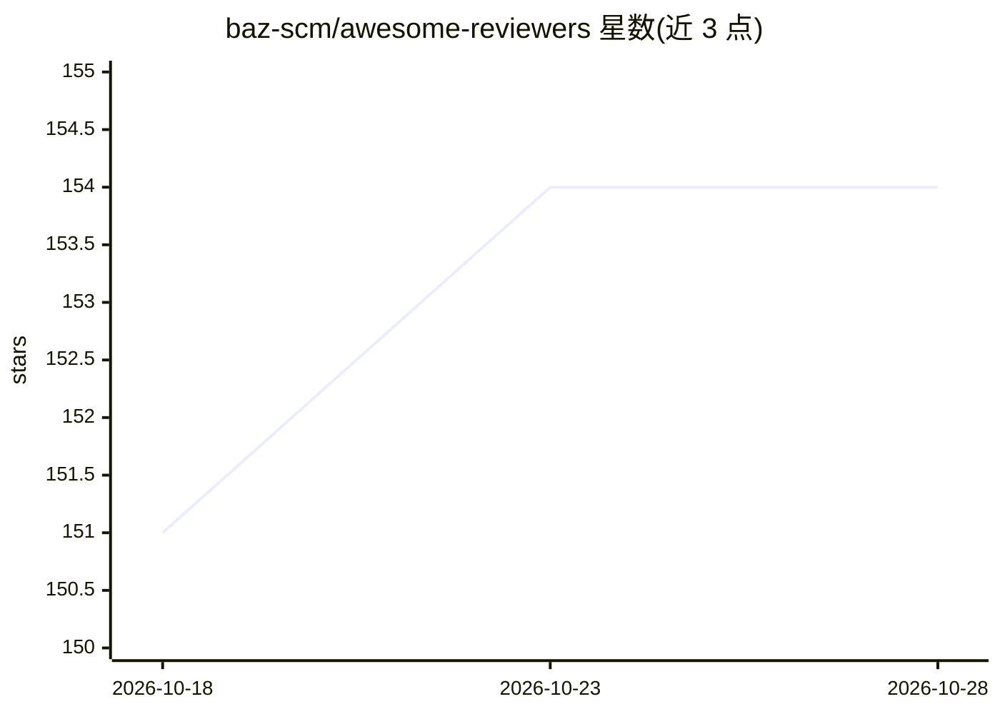

# baz-scm/awesome-reviewers

⭐ 154 · Python · Apache-2.0 · 推送 2026-10-27 · [GitHub](https://github.com/baz-scm/awesome-reviewers) · [官网](https://awesomereviewers.com/) · 组织维护

**代码评审系统提示词清单：面向 AI 与基础设施领域**

从生产开源仓库的代码评审讨论中提炼的即用型工程指令集合：每条指令包含规则、存在原因及示例，以纯 markdown 形式提供，可置入 agent、评审工具、上下文代理或手工组装的提示词中。内容按 12 个领域（ai-agents、llm-infra、ml-systems、security 等）组织，通过静态网站与无鉴权的静态 API（含 /llms.txt、OpenAPI 3.1 描述）分发，条目携带来源评审日期以支持增量拉取。仓库本身由 Baz 团队维护，采用 Jekyll 构建，构建脚本仅依赖标准库。

## 筛选速览

| 维度 | 判定 | 备注 |
|---|---|---|
| AI 角色 | `ai-knowledge` | 知识聚合/清单类 |
| 许可风险 | `permissive` | Apache-2.0 |
| 部署形态 | `library` | 以包/库形式分发 |
| 模型依赖 | — | README 未给出锁定关系 |
| 硬件要求 | — | 无带数字的原话,不猜 |
| 安装摩擦 | `low` | 无编译、无系统依赖或容器化 |
| 成熟度 | — | 结构信号不足 |

## 能力要点

- 每条指令自包含：规则 + 原因 + 示例，纯 markdown 格式
- 覆盖 12 个领域的分类体系与跨领域的主题/语言过滤
- 静态文件 API：无 key、无限流，提供 /llms.txt 与 OpenAPI 3.1 描述
- 指令携带来源评审日期，可对 index.json 做增量 diff

## 适用场景

- 为编码 agent 或代码评审工具装配领域专家指令
- 按领域/主题/语言筛选查找特定技术栈的评审规则
- 通过静态 API 将指令索引接入自己的自动化流程

## 场景标签

`提示工程` `精选清单` · 领域:Agent 开发

## 证据(README 行号)

> L8: Each entry is a self-contained instruction — a rule, why it exists, and usually an example — written
> L9: from recurring reviewer feedback in one repository. They are plain markdown, so they drop into an
> L3: Expert engineering instructions for AI and infrastructure domains, distilled from code review

## 星数曲线

2026-10-18 151 → 2026-10-28 154（+3）

---
*卡片 v1 · prompt 1.4 · 生成 2026-10-23 · 置信度 mid · 依据 README sha `3d50eabdba57` · [字段定义](../../DATASET.md)*
