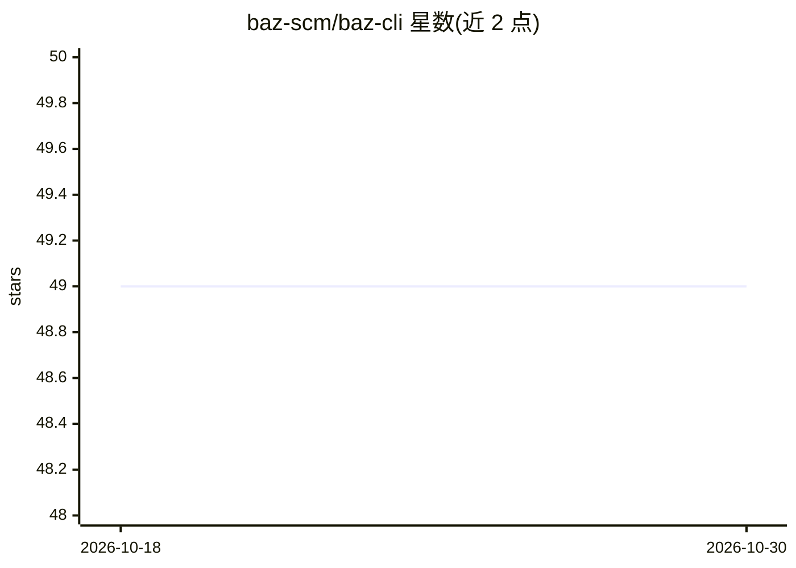

# baz-scm/baz-cli

⭐ 49 · TypeScript · AGPL-3.0 · 推送 2026-09-29 · [GitHub](https://github.com/baz-scm/baz-cli) · [官网](https://docs.baz.co) · 组织维护

**终端中 AI 引导的 Pull Request 代码审查 CLI**

基于 Node.js/TypeScript 的命令行工具，在终端中审查 GitHub Pull Request：AI 引导逐条走查变更，可查看摘要、diff 与评论，并直接创建评论、批准或合并 PR。提供两种模式——独立模式自带 GitHub PAT 与 Anthropic token，不依赖 Baz 服务；集成模式连接 Baz 平台，增加 Jira/Linear/YouTrack 工单上下文与 AI 规格审查（对照需求验证实现）。支持主题配色与滚动交互配置，npm 全局安装。

## 筛选速览

| 维度 | 判定 | 备注 |
|---|---|---|
| AI 角色 | `ai-enhanced` | 去掉 AI 部分产品仍成立 |
| 许可风险 | `viral` | AGPL-3.0 |
| 部署形态 | `library` | 以包/库形式分发 |
| 模型依赖 | — | README 未给出锁定关系 |
| 硬件要求 | — | 无带数字的原话,不猜 |
| 安装摩擦 | `low` | 无编译、无系统依赖或容器化 |
| 成熟度 | — | 结构信号不足 |

## 能力要点

- AI 引导的 PR 逐条走查与对话式问答
- 独立模式使用自有 GitHub PAT 与 Anthropic token，数据不经 Baz 服务
- 终端内直接创建评论、批准并合并 PR
- 集成模式提供工单上下文关联与 AI 规格审查

## 适用场景

- 在终端里审查并合并 GitHub PR，不用切浏览器
- AI 帮我梳理 PR 改动，只重点看关键部分
- 对照 Jira/Linear 工单要求检查 PR 是否满足规格

## 场景标签

`代码审查` · 领域:编码与开发

## 证据(README 行号)

> L20: **Let AI guide you through reviews**, helping you focus on what matters while skimming through the rest. Get intell
> L52: GH_TOKEN=your_github_pat ANTHROPIC_TOKEN=your_anthropic_api_key baz
> L57: Connect with Baz to get the full experience: AI assistant, spec review, better context, and comprehensive code revi

## 星数曲线

2026-10-18 49 → 2026-10-30 49（+0）

---
*卡片 v1 · prompt 1.4 · 生成 2026-10-24 · 置信度 high · 依据 README sha `731761bb7c17` · [字段定义](../../DATASET.md)*
