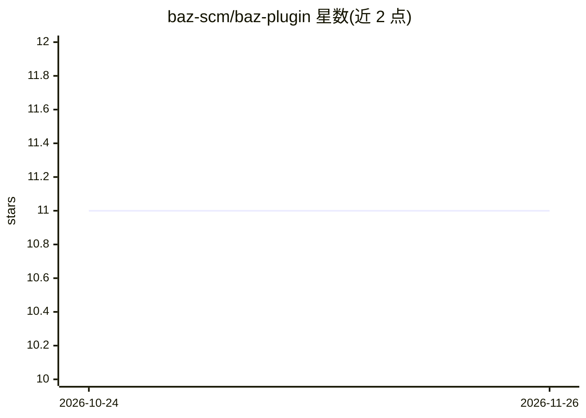

# baz-scm/baz-plugin

⭐ 11 · JavaScript · MIT · 推送 2026-11-19 · [GitHub](https://github.com/baz-scm/baz-plugin) · [官网](https://baz.ai) · 组织维护

**给编码 Agent 提供跨仓库索引检索与代码评审的插件**

为 Claude Code、OpenAI Codex CLI、Cursor 等编码 Agent 提供三个索引搜索工具（repo_search 语义搜索、remote_grep 正则检索、remote_file_search 文件名搜索），并附带计划、评论汇总与代码评审命令。面向未在本地检出的仓库做跨组织索引搜索，无需 clone 且无速率限制；评审时读取组织在 Baz 配置的评审准则，跨仓库检查未连接时明确声明覆盖范围。通过各平台插件市场安装，OAuth 认证。

## 筛选速览

| 维度 | 判定 | 备注 |
|---|---|---|
| AI 角色 | `ai-ecosystem` | LLM/agent 周边工具 |
| 许可风险 | `permissive` | MIT |
| 部署形态 | `None` |  |
| 模型依赖 | — | README 未给出锁定关系 |
| 硬件要求 | — | 无带数字的原话,不猜 |
| 安装摩擦 | `low` | 无编译、无系统依赖或容器化 |
| 成熟度 | — | 结构信号不足 |

## 能力要点

- 三个索引搜索工具：语义搜索、路径限定正则 grep、glob 文件名搜索
- 提供 plan-with-baz 计划生成与 get-plan-comments 评论回读命令
- review 命令按组织配置的评审准则检查变更并给出 file:line 与修复
- Agent 保持只读直到用户批准；未连接 Baz 时拒绝给出跨仓库检查结论

## 适用场景

- 针对未本地检出的仓库规划功能改动
- 让 AI 评审覆盖其他仓库中对本次变更的调用方
- 把 Baz 上的计划评审意见拉回 Agent 会话处理

## 场景标签

`代码审查` `语义搜索` · 领域:编码与开发

## 证据(README 行号)

> L3: The Baz plugin adds three indexed search tools to your agent — `repo_search`, `remote_grep`, and `remote_file_search
> L5: Designed for planning features against repositories you haven't checked out locally. Indexed search across the whole
> L106: **The cross-repo checks require Baz to be connected.** If it isn't, the review won't silently shrink to a local on

## 星数曲线

2026-10-24 11 → 2026-11-26 11（+0）

---
*卡片 v1 · prompt 1.4 · 生成 2026-11-18 · 置信度 high · 依据 README sha `ab1a546e656c` · [字段定义](../../DATASET.md)*
