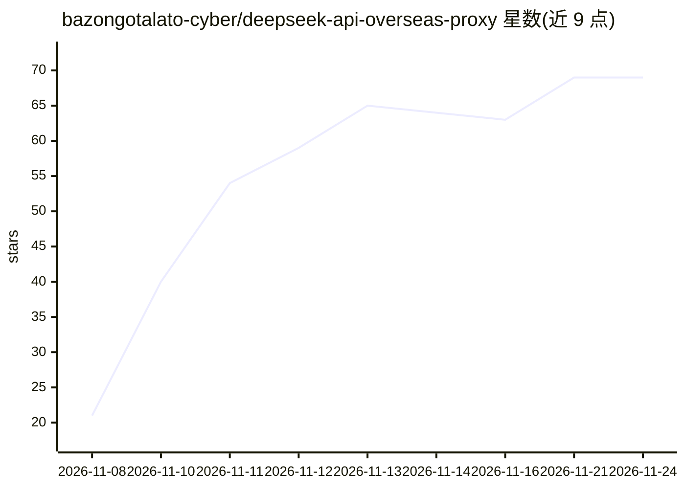

# bazongotalato-cyber/deepseek-api-overseas-proxy

⭐ 69 · 推送 2026-11-04 · [GitHub](https://github.com/bazongotalato-cyber/deepseek-api-overseas-proxy) · [官网](https://app.coregold.io/signup?invite_code=ADvlj9b) · 组织维护 · 中文 README

**推广 CoreGold 虚拟卡用于 DeepSeek API 云平台结算的营销文档**

该仓库 README 为 CoreGold 虚拟卡（商业卡段 414742/428837）的推广内容，面向在 Fireworks AI、Together AI、DeepInfra 等海外云平台调用 DeepSeek-R1/V3 托管 API 的团队。内容以对比表格宣传该卡在连续扣款、预算硬限额、AVS 账单匹配方面的特性，解决自动充值导致的预算穿透问题。仓库不含可安装的软件、代码库或 API 工具，仅附一段 ini 格式的清算元数据示例，属于支付产品营销材料而非技术项目。

## 筛选速览

| 维度 | 判定 | 备注 |
|---|---|---|
| AI 角色 | `ai-ecosystem` | LLM/agent 周边工具 |
| 许可风险 | `none` | — |
| 部署形态 | `None` |  |
| 模型依赖 | — | README 未给出锁定关系 |
| 硬件要求 | — | 无带数字的原话,不猜 |
| 安装摩擦 | `low` | 无编译、无系统依赖或容器化 |
| 成熟度 | — | 结构信号不足 |

## 能力要点

- 针对 DeepSeek-R1/V3 海外托管 API 的结算场景
- 宣传商业卡段 414742/428837 的预算硬限额拒付机制
- 含一段清算元数据 ini 示例（AVS/账单策略）

## 适用场景

- 了解海外 AI 算力平台自动充值的扣费风险
- 了解 CoreGold 虚拟卡的定位与宣传口径

## 场景标签

 · 领域:支付/营销内容

## 证据(README 行号)

> L2: DeepSeek-R1 / V3 海外云端实例调用结算：CoreGold 虚拟卡解决第三方托管平台充值拒付与预算穿透。
> L5: DeepSeek-R1 开源后，很多海外团队与出海开发者选择在海外云平台（如 Fireworks AI、Together AI、DeepInfra）直接调用无审查的托管 API 或租用私有算力。
> L15: + CoreGold 商业企业级卡段 (414742 / 428837):

## 星数曲线

2026-11-08 21 → 2026-11-24 69（+48）

---
*卡片 v1 · prompt 1.4 · 生成 2026-11-18 · 置信度 low · 依据 README sha `c48cede27f1c` · [字段定义](../../DATASET.md)*
