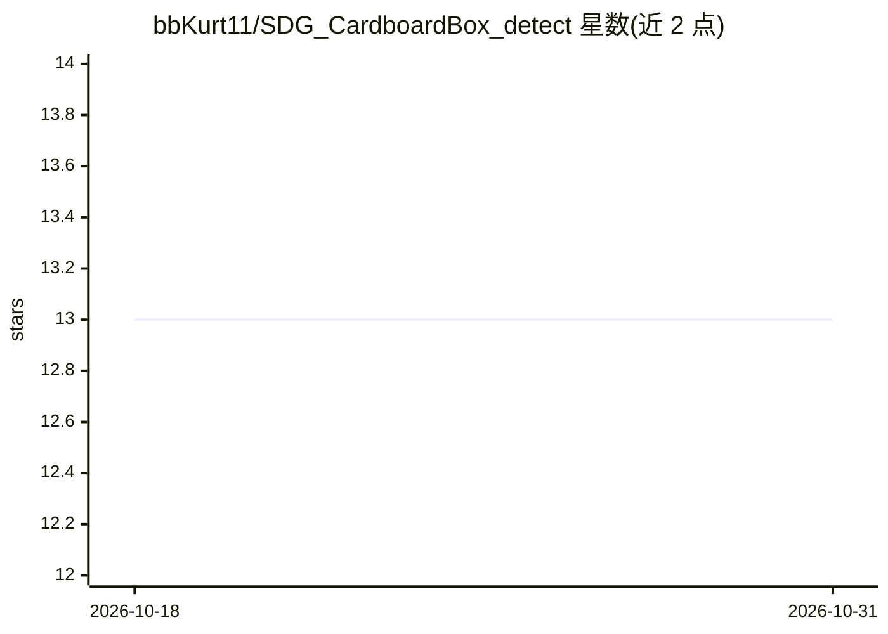

# bbKurt11/SDG_CardboardBox_detect

⭐ 13 · Python · MIT · 推送 2026-06-09 · [GitHub](https://github.com/bbKurt11/SDG_CardboardBox_detect) · [官网](https://www.youtube.com/watch?v=2sVSZpJezgQ) · 个人维护

**Blender 合成数据+两阶段 YOLOv8 的纸箱缺陷检测研究项目**

单人 3 个月研究型仓库：用 Blender Cycles 渲染做域随机化合成数据生成（自动 YOLO 标注），训练两阶段 YOLOv8n（YOLO1 定位箱体、YOLO2 检测污渍/穿孔），实现实时摄像头推理，报告 93% 缺陷命中与 0% 误报。核心内容是四项消融发现（真实负样本锚点、epoch 早锁、双重增强破坏细粒度特征、Sim-to-Real 差距依特征而定），并与 NVIDIA SDG 方法对齐。限制：验证集仅 30 图、未做跨相机验证、管线绑定纸箱对象不可即插即用；Blender 场景文件不入库，需自备场景；推理脚本与预训练权重可独立运行。

## 筛选速览

| 维度 | 判定 | 备注 |
|---|---|---|
| AI 角色 | `ai-native` | 本体是模型或模型工具 |
| 许可风险 | `permissive` | MIT |
| 部署形态 | `None` |  |
| 模型依赖 | — | README 未给出锁定关系 |
| 硬件要求 | `gpu-8g` | |
| 安装摩擦 | `medium` | 含编译或系统依赖之一 |
| 成熟度 | — | 结构信号不足 |

## 能力要点

- Blender 合成数据流水线（渲染+Mask 自动标注，6,000+ 图数据集）
- 两阶段 YOLOv8n 实时摄像头推理，提供预训练权重
- 5 组对照消融实验与 P001–P014 工程记录
- 复现并对齐 NVIDIA SDG 方法，补充负样本锚点发现

## 适用场景

- 工业质检场景研究小样本合成数据训练方案
- 参考其消融结论设计自己的 Sim-to-Real 混合训练
- 用预训练权重直接运行纸箱缺陷实时检测演示

## 场景标签

`目标检测` · 领域:感知与多模态

## 证据(README 行号)

> L176: python 02_Scripts\11_realtime_demo.py
> L141: Webcam frame (640×480)

## 星数曲线

2026-10-18 13 → 2026-10-31 13（+0）

---
*卡片 v1 · prompt 1.4 · 生成 2026-10-31 · 置信度 high · 依据 README sha `7790ace66f9e` · [字段定义](../../DATASET.md)*
