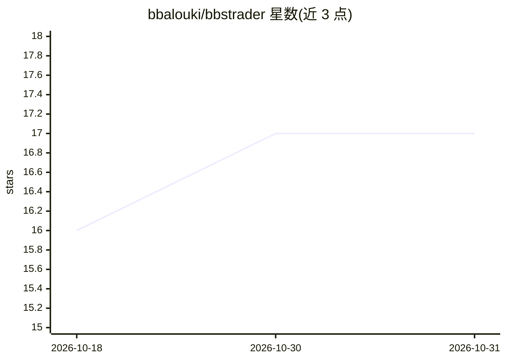

# bbalouki/bbstrader

⭐ 17 · Python · MIT · 推送 2026-08-10 · [GitHub](https://github.com/bbalouki/bbstrader) · [官网](https://github.com/bbalouki/bbstrader) · 个人维护

**面向量化交易者的 C++/Python 混合交易与回测工具包**

bbstrader 是用 C++ 与 Python 构建的投资交易工具包：C++ 层承担高频信号生成与低延迟执行，Python 层负责编排、数据分析和 ML 模型。核心模块包括事件驱动回测引擎（含滑点、佣金、部分成交、延迟等现实性建模及向量化快速回测路径）、经 C++/Python 桥接的 MetaTrader 5 集成（含 Account API 与断线重试）、实盘交易编排器（多账户、对冲、追踪止损），以及提供情绪分析与主题建模的模型模块。以 pip 包分发，支持 CLI 与 GUI（当前 GUI 用于跟单监控），跨 Windows/macOS/Linux，IBKR 集成声明在开发中。

## 筛选速览

| 维度 | 判定 | 备注 |
|---|---|---|
| AI 角色 | `ai-enhanced` | 去掉 AI 部分产品仍成立 |
| 许可风险 | `permissive` | MIT |
| 部署形态 | `library` | 以包/库形式分发 |
| 模型依赖 | — | README 未给出锁定关系 |
| 硬件要求 | — | 无带数字的原话,不猜 |
| 安装摩擦 | `low` | 无编译、无系统依赖或容器化 |
| 成熟度 | — | 结构信号不足 |

## 能力要点

- 事件驱动回测引擎与 vectorized_backtest 向量化快速回测双路径
- C++/Python 双向桥接的 MetaTrader 5 集成（MetaTraderClient 与 Account API）
- 回测现实性建模：滑点、市场冲击、佣金、部分成交、延迟、隔夜资金成本
- 参数优化与过拟合诊断（PBO/CSCV、deflated Sharpe）及 VaR/CVaR 风险分析

## 适用场景

- 用历史数据回测并优化多资产交易策略
- 构建接入 MetaTrader 5 的实盘策略，C++ 承担低延迟逻辑
- 用情绪分析等模型生成交易信号
- 管理主从账户间的跟单复制

## 场景标签

`金融量化` `数据分析` · 领域:效率与自动化

## 证据(README 行号)

> L26: Imagine having the raw, blistering speed of C++ for your high-frequency trades, combined with Python's ecosystem fo
> L227: - **Purpose**: Build/test models like NLP sentiment, VaR/CVaR risk, optimization.
> L228: - **Features**: Currently Sentiment analysis, and Topic Modeling.

## 星数曲线

2026-10-18 16 → 2026-10-31 17（+1）

---
*卡片 v1 · prompt 1.4 · 生成 2026-10-30 · 置信度 mid · 依据 README sha `eff3b9bbab27` · [字段定义](../../DATASET.md)*
