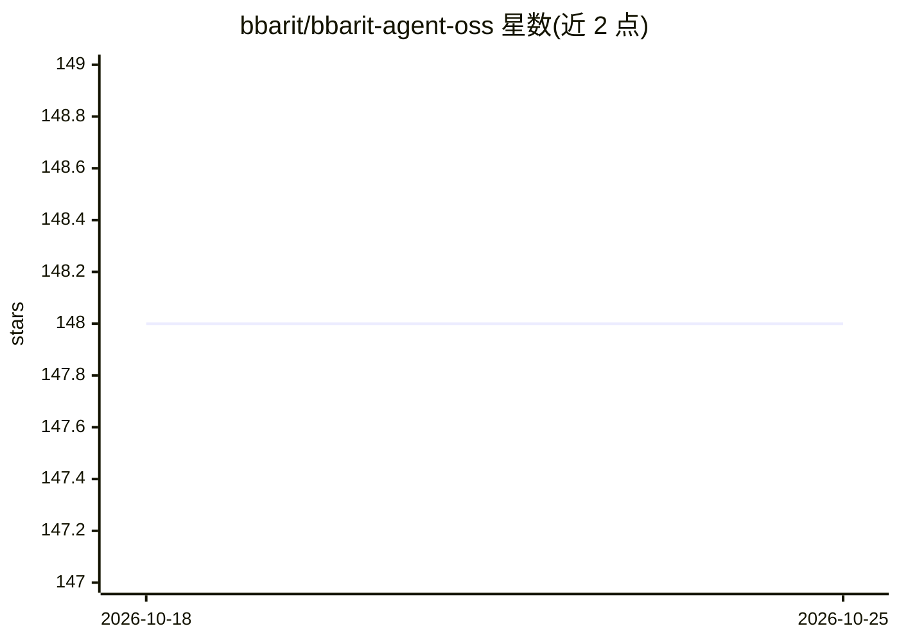

# bbarit/bbarit-agent-oss

⭐ 149 · Rust · NOASSERTION · 推送 2026-07-21 · [GitHub](https://github.com/bbarit/bbarit-agent-oss) · [官网](https://bbarit.com) · 组织维护 · 中文 README

**终端里的开源 AI 编程 agent，单一 Rust 二进制，多模型接入**

用 Rust 从零实现的终端 AI 编程代理：读写编辑代码、执行 shell、仓库内 BM25+语义混合代码搜索、抓取网页，并可派生并行子代理。单一静态二进制分发，无需 Node/Python 运行时；通过统一模型注册表接入 Anthropic、OpenAI、Gemini、Ollama 等 15+ 提供商、1,000+ 模型，会话中可切换。含项目 wiki、295 个领域角色、跨会话自动记忆（沿用 qwen-code 分类设计），/interop 可复用 Claude Code 与 Codex 的 MCP 服务器和技能。提供 TUI 与非交互输出模式（--print/--mode json）。自述为 Claude Code/Codex CLI 的可自托管替代。

## 筛选速览

| 维度 | 判定 | 备注 |
|---|---|---|
| AI 角色 | `ai-native` | 本体是模型或模型工具 |
| 许可风险 | `none` | NOASSERTION |
| 部署形态 | `desktop` | 安装包/桌面程序 |
| 模型依赖 | local-ok | 支持本地模型 |
| 硬件要求 | — | 无带数字的原话,不猜 |
| 安装摩擦 | `medium` | 含编译或系统依赖之一 |
| 成熟度 | — | 结构信号不足 |

## 能力要点

- 读写/编辑文件、执行 shell、混合 BM25+语义代码搜索的自主工具循环
- 单一静态 Rust 二进制，macOS/Linux/Windows 一行安装，--upgrade 自更新
- 15+ 提供商、1,000+ 模型的统一注册表，含 Ollama 本地模型
- 295 个领域角色与并行子代理编排（--orchestrate）

## 适用场景

- 在终端里让 AI 代为读代码、改代码、跑命令
- 用 --print 模式嵌入脚本或其他 agent 的处理链
- 接入本地 Ollama 模型实现离线编程助手
- 复用已有的 Claude Code/Codex MCP 服务器与技能

## 场景标签

`编码 Agent` · 领域:编码与开发

## 证据(README 行号)

> L112: **bbarit-oss** is a fast, terminal-native **AI coding agent** — an open-source
> L116: **Anthropic Claude, OpenAI GPT / Codex, Google Gemini, and a dozen more

## 星数曲线

2026-10-18 148 → 2026-10-25 148（+0）

---
*卡片 v1 · prompt 1.4 · 生成 2026-10-22 · 置信度 mid · 依据 README sha `6a19cf07f0c3` · [字段定义](../../DATASET.md)*
